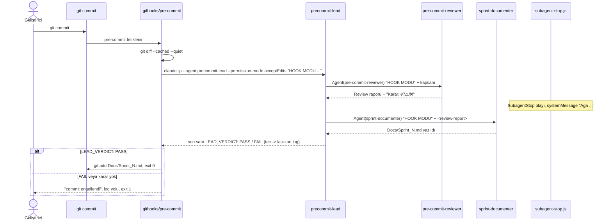
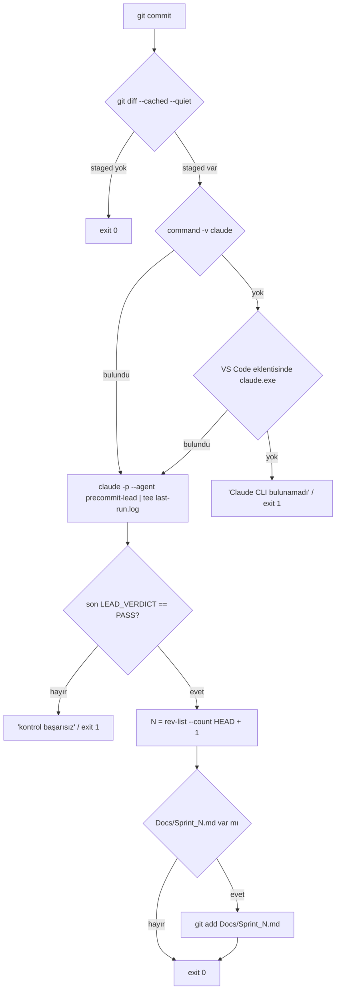
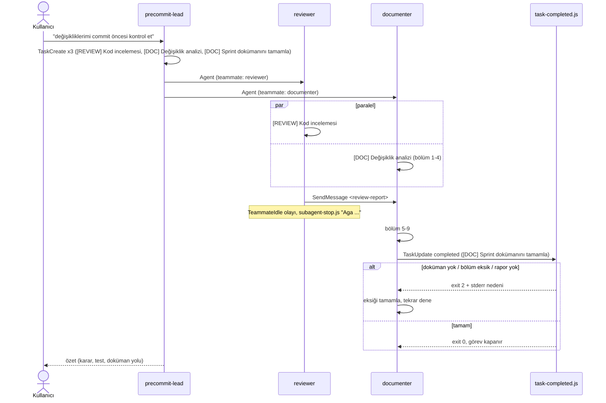
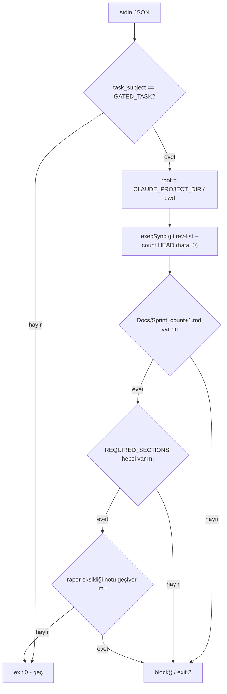
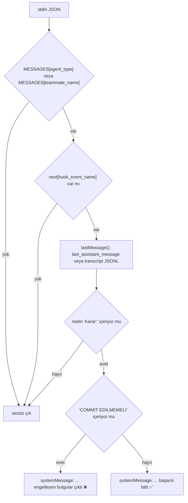

# Sprint 1

| Alan | Değer |
|---|---|
| Tarih | 2026-11-02 13:55 |
| Branch | master |
| Yazar | Azad_ |
| Review kararı | ⚠️ DÜZELTMELERLE COMMIT EDİLEBİLİR (Kritik: 0, Yüksek: 0, Orta: 1, Düşük/Bilgi: 9) |

## 1. Özet

Bu, deponun ilk commit'idir. Commit öncesi otomatik kalite kapısı kuruluyor. Kapı, Claude Code agent'larından oluşan üç rollü bir takımdan (`precommit-lead`, `pre-commit-reviewer`, `sprint-documenter`), bir git `pre-commit` hook'undan ve Claude Code olaylarına bağlı iki Node.js hook script'inden oluşuyor. Her `git commit`'te staged değişiklikler SOLID, test ve güvenlik açısından inceleniyor, `Docs/Sprint_{N}.md` dokümanı üretiliyor ve sonuç `LEAD_VERDICT: PASS` değilse commit engelleniyor. Sistem iki modda çalışıyor: commit sırasında etkileşimsiz "subagent / HOOK MODU", elle açılan oturumda ise deneysel "agent team" modu. Commit'te kurulumu anlatan bir `README.md`, WSL/tmux kurulum notu ve AI agent kavramlarını anlatan eğitim notları da var.

## 2. Değişen Dosyalar

| Durum | Dosya | Açıklama |
|---|---|---|
| Eklendi | `.claude/agents/precommit-lead.md` | Takım lideri agent. Takım modunda teammate ve görev listesi yönetir. HOOK MODU'nda alt agent'ları sırayla çağırır ve `LEAD_VERDICT` satırını üretir. |
| Eklendi | `.claude/agents/pre-commit-reviewer.md` | SOLID/tasarım, test ve güvenlik incelemesi yapan, karar kriterleri tanımlı reviewer agent. |
| Eklendi | `.claude/agents/sprint-documenter.md` | Değişiklikleri ve review raporunu `Docs/Sprint_{N}.md` dosyasına yazan documenter agent. |
| Eklendi | `.claude/hooks/subagent-stop.js` | `SubagentStop` / `TeammateIdle` olaylarında reviewer bitince chat'e durum mesajı (`systemMessage`) yazar. |
| Eklendi | `.claude/hooks/task-completed.js` | `TaskCompleted` olayında `[DOC] Sprint dokümanını tamamla` görevi için doküman kapısı uygular (exit 2). |
| Eklendi | `.claude/settings.json` | Varsayılan agent, Bash izin listesi, agent team ortam değişkeni ve hook tanımları. |
| Eklendi | `.gitattributes` | `.githooks/*` dosyalarını LF satır sonuyla sabitler. |
| Eklendi | `.githooks/pre-commit` | `claude -p --agent precommit-lead` çalıştıran, sonuca göre commit'i durduran POSIX sh hook'u. |
| Eklendi | `README.md` | Sistemin genel bakışı, kurulum, kullanım, engelleme kuralları, sorun giderme ve agent team modu. |
| Eklendi | `General Documents/WSL.md` | WSL + tmux ile her teammate'i ayrı panelde çalıştırma kurulum notu. |
| Eklendi | `Egitim Notlari/EgitimNotları.md` | AI Agent tanımı, agent katmanları, idempotency ve otonomi seviyeleri üzerine eğitim notları. |
| Eklendi | `Egitim Notlari/HowWorksAgent.png` | Eğitim notunda kullanılan görsel (ikili dosya). |
| Eklendi | `Egitim Notlari/Core_Components_of_Agent.png` | Eğitim notunda kullanılan görsel (ikili dosya). |
| Eklendi | `Egitim Notlari/OtonomiLevel.png` | Eğitim notunda kullanılan görsel (ikili dosya). |

Değiştirilen veya silinen dosya yok. Review sürecinde test dosyası yazılmadı.

## 3. Detaylı Değişiklik Açıklamaları

### 3.1 `.githooks/pre-commit` - Commit kalite kapısı

- **Ne değişti:** Yeni bir POSIX sh pre-commit hook'u eklendi.
- **Neden:** Her commit'in agent incelemesinden ve dokümantasyondan geçmesini zorunlu kılmak için.
- **Nasıl çalışıyor:**
  1. `git rev-parse --show-toplevel` ile repo köküne geçer.
  2. `git diff --cached --quiet` başarılıysa (staged değişiklik yoksa) `exit 0` ile çıkar.
  3. Claude CLI'ı önce `PATH`'te (`command -v claude`) arar. Bulamazsa `$HOME/.vscode/extensions/anthropic.claude-code-*/resources/native-binary/claude.exe` altındaki en yeni sürümü `sort -V | tail -n 1` ile seçer. İkisi de yoksa commit'i engeller (`exit 1`).
  4. `claude -p --agent precommit-lead --permission-mode acceptEdits "HOOK MODU: ..." < /dev/null` çalıştırır. Çıktı `tee` ile `$(git rev-parse --git-dir)/precommit-lead/last-run.log` dosyasına da yazılır.
  5. Log'daki son `LEAD_VERDICT: [A-Z]*` eşleşmesi `LEAD_VERDICT: PASS` ise `N = rev-list --count HEAD + 1` hesaplar ve `Docs/Sprint_$N.md` varsa onu `git add` ile commit'e ekler, sonra `exit 0` döner.
  6. Diğer tüm durumlarda (karar yok, FAIL) log yolunu yazdırıp `exit 1` döner. Yani kapı fail-closed çalışır.
- **Etkilediği yerler:** Yalnızca `git config core.hooksPath .githooks` ayarı yapılmış klonlarda etkindir (README §2.2). `--no-verify` ile atlanabilir.

### 3.2 `.claude/agents/precommit-lead.md` - Takım lideri

- **Ne değişti:** Ana oturum agent'ı olarak çalışan lider agent tanımı eklendi. Tool listesi: `Agent(pre-commit-reviewer, sprint-documenter)`, `SendMessage`, `TaskCreate/Get/List/Update`, `Read`, `Glob`, `Grep`, `Bash`.
- **Neden:** Bir subagent başka bir subagent'ı çağıramaz. Bu yüzden reviewer ile documenter'ı yönetecek bir üst agent gerekiyor.
- **Nasıl çalışıyor:**
  - **Ön kontrol:** Depo olup olmadığına ve değişiklik varlığına bakar, kapsamı belirler (staged > working tree > kullanıcı listesi).
  - **Takım modu:** `[REVIEW] Kod incelemesi`, `[DOC] Değişiklik analizi` ve `[DOC] Sprint dokümanını tamamla` görevlerini birebir bu başlıklarla oluşturur. `reviewer` ve `documenter` adlı iki teammate başlatır ve mesajları kendisi taşımaz.
  - **HOOK MODU:** Önce `pre-commit-reviewer`'ı çağırır, sonra raporun tamamını `<review-report>` etiketleriyle `sprint-documenter`'a iletir. Reviewer kararı ✅/⚠️ ise ve doküman yazıldıysa sonuç PASS olur, aksi halde FAIL. Çıktının son satırı tam olarak `LEAD_VERDICT: PASS` ya da `LEAD_VERDICT: FAIL` olmalıdır.
- **Etkilediği yerler:** `.githooks/pre-commit` bu son satırı ayrıştırır. `task-completed.js` görev başlığına birebir bağlıdır.

### 3.3 `.claude/agents/pre-commit-reviewer.md` - Reviewer

- **Ne değişti:** İnceleme agent'ı eklendi (tools: `Read, Grep, Glob, Bash, Write, Edit`).
- **Nasıl çalışıyor:** Kapsamı belirler, teknoloji yığınını ve test framework'ünü tespit eder. SOLID ve genel tasarım kontrolü, test yazma/çalıştırma ve OWASP odaklı güvenlik taraması yapar. Raporu sabit bir şablonla üretir. Karar kuralları deterministiktir:
  - ❌: build hatası, başarısız test, herhangi bir Kritik/Yüksek bulgu ya da Orta ve üzeri güvenlik bulgusu.
  - ⚠️: Orta seviyeli tasarım bulgusu ya da Düşük/Bilgi seviyeli güvenlik bulgusu.
  - ✅: diğer durumlar.
  
  Takım modunda raporu `SendMessage` ile `documenter`'a gönderir. HOOK MODU'nda soru sormaz, varsayılanları uygular (ör. test projesi yoksa yalnızca senaryo listesi verir).
- **Etkilediği yerler:** Rapordaki `Karar:` satırı ve `COMMIT EDİLMEMELİ` ifadesi `subagent-stop.js` tarafından okunur.

### 3.4 `.claude/agents/sprint-documenter.md` - Documenter

- **Ne değişti:** Dokümantasyon agent'ı eklendi (tools: `Read, Grep, Glob, Bash, Write, Edit`).
- **Nasıl çalışıyor:** Staged diff'i tarar. `N = git rev-list --count HEAD + 1` (HEAD yoksa 1) ile `Docs/Sprint_{N}.md` yazar ya da günceller. Mermaid diyagramlarının hangi durumda kullanılacağını ve 9 bölümlük doküman şablonunu tanımlar. Yalnızca `Docs/` altına yazma kuralı vardır. Takım modunda review raporunu doğrudan `reviewer`'dan bekler.
- **Etkilediği yerler:** `task-completed.js` içindeki `REQUIRED_SECTIONS` sabiti bu şablonun başlıklarına bağlıdır.

### 3.5 `.claude/hooks/subagent-stop.js` - Reviewer bitiş bildirimi

- **Ne değişti:** `SubagentStop` ve `TeammateIdle` olaylarında çalışan Node.js script'i eklendi.
- **Nasıl çalışıyor:**
  - Olay JSON'unu stdin'den okur. Geçersiz JSON'da sessizce devam eder.
  - `MESSAGES` haritasında agent'ı önce `input.agent_type`, sonra `input.teammate_name` ile arar. Hem `pre-commit-reviewer` hem `reviewer` aynı `REVIEWER` mesaj nesnesine bağlıdır. `hook_event_name`'e göre (`SubagentStop` / `TeammateIdle`) bir "sıradaki adım" metni seçilir. Eşleşme yoksa sessizce çıkar.
  - `lastMessage()` önce `last_assistant_message` alanına bakar. Bu alan yoksa `agent_transcript_path` JSONL dosyasını sondan başa tarar ve ilk `assistant` girdisindeki `text` parçalarını birleştirir.
  - Metinde `Karar:` yoksa mesaj gösterilmez. Bu, inceleme bitmeden boşa düşen teammate'ler içindir. Varsa `COMMIT EDİLMEMELİ` ifadesinin geçip geçmemesine göre başarılı ya da engelleyici durum metni seçilir ve stdout'a `{"systemMessage": "Aga ..."}` yazılır.
- **Etkilediği yerler:** Yalnızca kullanıcıya gösterilen bilgi mesajıdır, akışı engellemez. Review bulguları için bkz. §6.

### 3.6 `.claude/hooks/task-completed.js` - Doküman tamamlama kapısı

- **Ne değişti:** `TaskCompleted` olayında çalışan Node.js script'i eklendi.
- **Nasıl çalışıyor:**
  - `task_subject` tam olarak `GATED_TASK` (`[DOC] Sprint dokümanını tamamla`) değilse hiçbir şey yapmaz.
  - Kök dizini `CLAUDE_PROJECT_DIR`, `input.cwd` ya da `process.cwd()` sırasıyla belirler. `execSync("git rev-list --count HEAD")` ile commit sayısını alır. Hata olursa (commit yoksa) sayı 0 kalır.
  - `Docs/Sprint_{count+1}.md` yoksa, `REQUIRED_SECTIONS` başlıklarından (`## 1. Özet`, `## 5. Test Sonuçları`, `## 6. Tasarım ve SOLID Değerlendirmesi`, `## 7. Güvenlik Değerlendirmesi`) biri eksikse ya da metinde rapor eksikliği notu (`sprint-documenter.md`'nin rapor gelmediğinde yazdığı ifade, `task-completed.js:56`) geçiyorsa `block()` çağrılır. `block()` stderr'e neden yazar ve `exit 2` ile çıkar. Böylece görev kapanmaz ve teammate'e geri bildirim gider.
- **Etkilediği yerler:** Yalnızca agent team modunda çalışır. Görev başlığı `precommit-lead.md` ile, bölüm başlıkları `sprint-documenter.md` şablonuyla eşleşmek zorundadır.

### 3.7 `.claude/settings.json` - Proje ayarları

- **Ne değişti:** Proje düzeyinde Claude Code ayarları eklendi.
- **İçerik:**
  - `"agent": "precommit-lead"`: Oturum doğrudan lider agent ile başlar.
  - `permissions.allow`: Salt-okunur git komutları (`git status/diff/log/rev-list/rev-parse/branch *`, `git config user.name`), ayrıca `date`, `mkdir` ve .NET, npm, Java ve Python ekosistemlerinin build/test/audit komutları. `git add/commit/push` listede yok. `node` da listede yok.
  - `env.CLAUDE_CODE_EXPERIMENTAL_AGENT_TEAMS = "1"`: Agent team özelliğini açar.
  - `hooks`: `SubagentStop` ve `TeammateIdle` olayları `subagent-stop.js`'e, `TaskCompleted` olayı `task-completed.js`'e bağlıdır. Komutlar `node "$CLAUDE_PROJECT_DIR/..."` biçimindedir.
- **Etkilediği yerler:** Tüm agent'ların etkileşimsiz modda çalıştırabileceği komutları bu liste belirler.

### 3.8 `.gitattributes`

- `.githooks/* text eol=lf` kuralı eklendi. Windows'ta CRLF dönüşümü yüzünden `#!/bin/sh` shebang'inin bozulması (`bad interpreter`) önlenir.

### 3.9 Dokümantasyon ve eğitim içerikleri

- **`README.md`:** Sistemin bileşenleri, Mermaid ile akış şeması, kurulum (`core.hooksPath`, izinler), günlük kullanım, engelleme kuralları tablosu, sprint dokümanı kuralları, `--no-verify` uyarısı, sorun giderme tablosu, dosya yapısı ve agent team modu.
- **`General Documents/WSL.md`:** WSL'de Ubuntu, tmux, git ve Claude Code kurulumu, `teammateMode: tmux` ayarı ve tmux kısayolları. Komutlar Markdown kod bloğu içinde değil.
- **`Egitim Notlari/EgitimNotları.md` ve 3 PNG:** AI Agent tanımı, 8 katmanlı agent mimarisi şeması, idempotency örneği (çift ödeme senaryosu), otonomi tanımı ve Seviye 0-5 otonomi sınıflandırması. Kodla ilişkisi yok.

## 4. Akış Diyagramları

### 4.1 HOOK MODU: commit sırasında çağrı sırası

`git commit` ile başlayan etkileşimsiz akış. `precommit-lead` alt agent'ları sırayla çağırır ve raporu kendisi taşır.



### 4.2 `.githooks/pre-commit` karar akışı

Script'in fail-closed davranışı. Belirsiz her dal `exit 1` ile biter.



### 4.3 Agent team modu: görevler ve mesajlaşma

Etkileşimli oturumda `reviewer` ve `documenter` paralel çalışır. Rapor lider üzerinden değil, doğrudan iletilir. Son görev `task-completed.js` kapısından geçmeden kapanmaz.



### 4.4 `task-completed.js` kapı mantığı



### 4.5 `subagent-stop.js` mesaj üretimi



## 5. Test Sonuçları

- **Sonuç:** 0 geçti / 0 başarısız / 0 atlandı (testler çalıştırılamadı).
- **Yazılan testler:** Yok. Depoda test projesi ve test framework'ü yok, `package.json` da yok. HOOK MODU varsayılanı gereği test projesi oluşturulmadı.
- **Çalıştırma notu:** Reviewer hook script'lerini örnek stdin ile smoke test etmek istedi ama izin sistemi buna izin vermedi. `node` komutu izin listesinde değil ve repo dışına geçici dosya yazılamıyor. Davranış bulguları statik analizle doğrulandı.

**Önerilen test senaryoları** (reviewer önerisi, ör. `node:test` ile `tests/hooks/*.test.js`):

| Test | Girdi | Beklenen |
|---|---|---|
| `SubagentStop_OnayKarari_BasariMesajiYazar` | `agent_type: pre-commit-reviewer`, mesajda `Karar: ✅` | stdout'ta `systemMessage` içinde "başarılı bitti" |
| `SubagentStop_RedKarari_EngelMesajiYazar` | `Karar: ❌ COMMIT EDİLMEMELİ` | "engelleyen bulgular" |
| `SubagentStop_UyariKarariRedIfadesiGeciyor_YanlisEngelYazmaz` | `Karar: ⚠️ ...`, metinde "COMMIT EDİLMEMELİ" de geçiyor | "engelleyen" yazmamalı (**mevcut kodda başarısız olur**) |
| `SubagentStop_GecersizJson_SessizCikar` | `bozuk` | exit 0, stdout boş |
| `SubagentStop_IlgisizAgent_SessizCikar` | `agent_type: other` | stdout boş |
| `TeammateIdle_KararYok_SessizCikar` | `Karar:` içermeyen mesaj | stdout boş |
| `TeammateIdle_TranscriptSonSatirBozuk_OncekiMesajiBulur` | JSONL'de son satır yarım | mesaj gösterilmeli (**mevcut kodda başarısız olur**) |
| `TeammateIdle_TranscriptCRLF_MesajiBulur` | CRLF satır sonlu JSONL | mesaj gösterilir |
| `TaskCompleted_IlgisizGorev_Gecer` | `task_subject: "x"` | exit 0 |
| `TaskCompleted_DokumanYok_Exit2` | boş geçici dizin | exit 2, stderr'de `Docs/Sprint_1.md bulunamadı` |
| `TaskCompleted_EksikBolum_Exit2` | doküman sadece §1 ve §5 içeriyor | exit 2, stderr'de §6 ve §7 eksik |
| `TaskCompleted_RaporIletilmedi_Exit2` | dokümanda rapor eksikliği notu (`task-completed.js:56` kalıbı) var | exit 2 |
| `TaskCompleted_TamDokuman_Exit0` | tüm bölümler var | exit 0 |
| `TaskCompleted_GecersizJson_Gecer` | `bozuk` | exit 0 |
| `PreCommit_VerdictYok_Exit1` | sahte `claude` çıktısında `LEAD_VERDICT` yok | exit 1 (fail-closed) |
| `PreCommit_PassVerdict_DokumaniStageEder` | sahte çıktı `LEAD_VERDICT: PASS` ve `Docs/Sprint_1.md` mevcut | exit 0, dosya index'te |

- **Kapsanmayan senaryolar:** Yukarıdaki senaryoların hiçbiri otomatik testle kapsanmıyor. `subagent-stop.js`, `task-completed.js` ve `.githooks/pre-commit` için hiç otomatik test yok.

## 6. Tasarım ve SOLID Değerlendirmesi

Reviewer raporundan olduğu gibi aktarılmıştır.

| Prensip / Konu | Dosya:Satır | Sorun | Öneri |
|---|---|---|---|
| **Orta**, işlevsel / fail-open | `.githooks/pre-commit` (index modu `100644`) | Hook dosyası git'te çalıştırılabilir değil. Windows'taki Git for Windows bunu yine de çalıştırır. Linux/macOS'ta ya da WSL'de Linux dosya sistemine yapılan bir klonda git hook'u yok sayar ve commit kontrolsüz geçer (en fazla bir "ignored hook" uyarısı çıkar). `/mnt/c` üzerindeki drvfs'te dosya izinleri 777 göründüğü için orada çalışabilir. **Doğrulanması gerekiyor.** | `git update-index --chmod=+x .githooks/pre-commit` (kullanıcı çalıştırmalı). README'deki kurulum adımına da ekleyin. |
| Düşük, doğruluk | `.claude/hooks/subagent-stop.js:53` | `text.includes("COMMIT EDİLMEMELİ")` tüm metinde arıyor. ⚠️ kararlı bir rapor kriter açıklamasında bu ifadeyi geçirirse yanlışlıkla "engelleyen bulgular çıktı ❌" mesajı yazılır. Ayrıca ⚠️ kararı "başarılı bitti ✅" olarak gösteriliyor. | Sadece karar satırını ayrıştırın: `const m = text.match(/Karar:\s*(✅\|⚠️\|❌)/u);` ve üç durum için ayrı mesaj yazın. |
| Düşük, hata yönetimi | `.claude/hooks/subagent-stop.js:24-35` | Döngü içindeki `JSON.parse` dıştaki tek `try` bloğunda. Transcript'in son satırı yarım yazılmışsa ilk satırda exception oluşur ve önceki geçerli mesajlar hiç denenmeden `""` döner, bildirim gösterilmez. | Parse işlemini döngü içinde ayrı bir `try { ... } catch { continue; }` bloğuna alın. |
| Düşük, DRY | `.githooks/pre-commit:38`, `.claude/hooks/task-completed.js:37-42`, `sprint-documenter.md` (Adım 3) | Sprint numarası (`rev-list --count HEAD + 1`) üç yerde ayrı ayrı hesaplanıyor. Biri değişirse diğerleri sessizce uyumsuz kalır. | Pragmatik çözüm: her yere "bkz. diğer konumlar" yorumu ekleyin. Tek bir küçük script'e taşımak burada fazla mühendislik olur. |
| Düşük, tasarım | Sprint numaralandırma | Commit sayısına dayalı numaralandırma paralel branch'lerde çakışır (iki branch da `Sprint_5.md` üretir). Merge, rebase ve amend sonrası da kayar. | Tek geliştirici ve lineer geçmiş için kabul edilebilir. Gerekirse README'de bu sınırı belirtin. |
| Düşük, sağlamlık | `.githooks/pre-commit:30` | `claude -p` çağrısı için zaman aşımı yok. CLI takılırsa commit süresiz bekler. | `timeout 900 "$CLAUDE_BIN" ...` (coreutils varsa) veya README'de `Ctrl+C` / `--no-verify` notu. |
| Düşük, git davranışı | `.githooks/pre-commit:40` | Pre-commit içindeki `git add` komutu `git commit <path>` ya da `-a` kullanımında geçici index'e yazar. Doküman commit'e girer ama ana index ile davranış farklı olabilir. | README'de "commit'i `git add` + `git commit` ile atın" notu yeterli. |
| Bilgi, coupling | `.claude/hooks/task-completed.js:11-19` | `GATED_TASK` ve `REQUIRED_SECTIONS` sabitleri `precommit-lead.md` ve `sprint-documenter.md` içindeki metinlere birebir bağlı. | Kabul edilebilir. Sabitlerin yanına kaynak md dosyalarını belirten bir yorum ekleyin. |
| Bilgi, doküman | `General Documents/WSL.md:31` | `echo '{ "teammateMode": "tmux" }' > ~/.claude/settings.json` komutu kullanıcının global Claude ayarlarının üzerine yazar ve mevcut ayarlar kaybolur. Dosyada Markdown kod blokları da yok, okunabilirlik düşük. | "Dosya yoksa oluşturun, varsa `teammateMode` alanını ekleyin" şeklinde yazın. Komutları ```` ```bash ```` bloklarına alın. |

**SOLID notu (reviewer):** Script'ler küçük ve tek sorumluluklu (SRP uygun). `MESSAGES` haritası yeni agent eklemeyi kodu değiştirmeden sağlıyor (OCP uygun). Daha fazla soyutlama önerilmiyor.

**İyi yapılanlar (reviewer):**
- `pre-commit` fail-closed: CLI bulunamazsa ya da karar satırı okunamazsa commit engelleniyor.
- `.gitattributes` ile `.githooks/*` için `eol=lf` zorunlu tutulmuş. Windows'ta CRLF yüzünden shebang bozulması önlenmiş.
- Hook script'leri geçersiz girdide sessizce ve güvenli çıkıyor. `execSync` sabit bir komutla çağrılıyor, injection yüzeyi yok.
- `TaskCompleted` kapısı dokümanın eksik bölümlerini ve review raporu olmadan yazılmasını engelliyor. Bu iyi bir deterministik kontrol.
- Agent rolleri ve yetkileri net ayrılmış (lider dosya yazmıyor, documenter sadece `Docs/` altına yazıyor). README kurulum, sorun giderme ve `--no-verify` uyarılarıyla kapsamlı.

## 7. Güvenlik Değerlendirmesi

Reviewer, koda gömülü sır taraması yaptı (`password|secret|api_key|token|connectionstring|sk-ant|ghp_`). Bulunan eşleşmelerin hepsi dokümantasyondaki açıklama metinleri. Commit edilen dosyalarda gerçek bir sır yok.

| Seviye | Dosya:Satır | Sorun | Öneri |
|---|---|---|---|
| Düşük | `.claude/settings.json:9` | `Bash(git branch *)` izni `git branch -D/-m/-f` komutlarını da onay sormadan açıyor. Agent'ların "depo durumunu değiştirme" kuralı sadece prompt'ta yazıyor. Commit edilen bir dosyadaki prompt injection dalı sildirebilir. | İzni okuma ile sınırlayın: `Bash(git branch --show-current)`, `Bash(git branch --list *)` |
| Düşük | `.claude/settings.json:5` | `Bash(git diff *)` izni `git diff --output=<dosya>` ile istenen bir dosyanın üzerine yazmaya izin veriyor. | Pratikte çoğu durumda kabul edilebilir. Daha sıkı isterseniz `Bash(git diff --cached*)`, `Bash(git diff --stat*)` gibi daraltın. |
| Bilgi | `.githooks/pre-commit:30-34` | Kalite kapısı LLM çıktısındaki `LEAD_VERDICT: PASS` satırına bakıyor. Staged bir dosyaya gömülü bir prompt injection teorik olarak kararı etkileyebilir. Hook zaten `--no-verify` ile atlanabildiği için bu bir güvenlik sınırı değil. | Bu kapıyı "yardımcı kontrol" olarak konumlandırın. Zorunlu kontrolleri (secret scan vb.) deterministik araçlarla yapın, ör. gitleaks. |
| Bilgi | `.githooks/pre-commit:30` | `--permission-mode acceptEdits` alt agent'ların proje içindeki her dosyaya yazmasına izin veriyor. "Üretim koduna dokunma" kuralını yalnızca prompt sağlıyor. | Kabul edilebilir. İsterseniz `permissions.deny` ile `Edit`/`Write` kapsamını `Docs/**` ve test klasörleriyle sınırlayın. |

## 8. Açık Konular ve Teknik Borç

Karar ⚠️ olduğu için aşağıdaki bulgular düzeltilmeden commit ediliyor ve sonraki sprint'lere kalıyor.

**Öncelikli (Orta):**
- [ ] `.githooks/pre-commit` dosyasını git'te çalıştırılabilir yapın: `git update-index --chmod=+x .githooks/pre-commit`. README §2.2'ye de ekleyin. Linux/macOS/WSL-native klonlarda bu yapılmazsa kapı fail-open çalışır. (Index modunun `100644` olduğu reviewer raporundan alınmıştır. Documenter bunu ayrıca doğrulayamadı. **Doğrulanması gerekiyor.**)

**Güvenlik sıkılaştırma (Düşük/Bilgi):**
- [ ] `settings.json` içindeki `Bash(git branch *)` iznini salt-okunur alt komutlarla sınırlayın.
- [ ] Gerekirse `Bash(git diff *)` iznini daraltın (`--output` riski).
- [ ] `permissions.deny` ile `Edit`/`Write` kapsamını `Docs/**` ve test klasörleriyle sınırlamayı değerlendirin.
- [ ] Agent çağrısından önce `pre-commit`'e deterministik bir secret scan ekleyin (ör. `gitleaks protect --staged`).

**Kod düzeltmeleri (Düşük):**
- [ ] `subagent-stop.js`: Karar yalnızca `Karar:` satırından ayrıştırılsın ve ✅/⚠️/❌ için üç ayrı mesaj yazılsın.
- [ ] `subagent-stop.js`: Transcript döngüsünde her satırın `JSON.parse` işlemi ayrı `try/catch` içine alınsın (`continue`).
- [ ] `pre-commit`: `claude -p` çağrısına zaman aşımı eklensin ya da README'ye `Ctrl+C` / `--no-verify` notu yazılsın.
- [ ] Sprint numarası hesabının üç konumuna (`pre-commit:38`, `task-completed.js`, `sprint-documenter.md`) çapraz referans yorumları eklensin.
- [ ] `GATED_TASK` / `REQUIRED_SECTIONS` sabitlerinin yanına kaynak md dosyaları yorum olarak yazılsın.

**Dokümantasyon:**
- [ ] README'de commit sayısına dayalı numaralandırmanın paralel branch, rebase ve amend sınırları belirtilsin.
- [ ] README'ye "commit'i `git add` + `git commit` ile atın (`-a` / `<path>` ile değil)" notu eklensin.
- [ ] `General Documents/WSL.md`: Global `~/.claude/settings.json` üzerine yazan `echo ... >` komutu düzeltilsin ve komutlar `bash` kod bloklarına alınsın.
- [ ] Documenter gözlemi (review bulgusu değil): README §8 "Sisteme yeni bir agent eklemek" adımı `precommit-lead.md` içinde "Alt agent'lar" tablosu ve "Akış" bölümünden söz ediyor. Dosyadaki ilgili tablonun başlığı ise "Roller" ve ayrı bir "Akış" bölümü yok. README §8 dosya ağacında `Egitim Notlari/` ve `General Documents/` klasörleri de yer almıyor.

- [ ] Documenter gözlemi (review bulgusu değil): `task-completed.js:56` rapor eksikliği notunu tüm metinde düz `includes` ile arıyor. Bir doküman bu kalıbı yalnızca anlatmak için alıntılarsa bile görev kapanmaz. Bu dokümanda kalıp bu nedenle birebir yazılmadı. Kontrol, `## 5.` bölümündeki belirli bir işaretleyici satırla sınırlandırılabilir.

**Test altyapısı:**
- [ ] Hook script'leri için §5'teki senaryolarla `node:test` tabanlı testler yazılsın. Bunun için `settings.json` izinlerine `Bash(node --test *)` eklenmeli ve gerekirse minimal bir `package.json` (`"test": "node --test"`) oluşturulmalı.

## 9. Revizyon Geçmişi

| Tarih | Açıklama |
|---|---|
| 2026-11-02 13:55 | İlk sürüm. Pre-commit agent sistemi, hook'lar, ayarlar, README ve eğitim notları dokümante edildi. pre-commit-reviewer raporu (⚠️) işlendi. |
