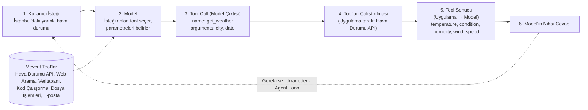

# Sprint 2

| Alan | Değer |
|---|---|
| Tarih | 2026-11-02 17:08 |
| Branch | master |
| Yazar | Azad_ |
| Review kararı | ✅ COMMIT EDİLEBİLİR |

## 1. Özet
Bu commit, eğitim notlarına (`Egitim Notlari/EgitimNotları.md`) yeni bir bölüm ekliyor: **"III) Tool ve Tool Calling"**. Bölümde ders slaytlarından alınan üç ekran görüntüsü var: Tool / Tool Calling tanımı, bir tool'un Description ve Schema'dan oluşan tanımı ve `get_weather` örneği üzerinden uçtan uca Tool Call akışı. Ayrıca MCP (Model Context Protocol) tool spesifikasyonunun resmi linki eklendi. Değişiklik yalnızca doküman ve görsellerden oluşuyor; kaynak kod, build ya da test etkisi yok.

## 2. Değişen Dosyalar
| Durum | Dosya | Açıklama |
|---|---|---|
| Değiştirildi | `Egitim Notlari/EgitimNotları.md` | "III) Tool ve Tool Calling" bölümü, alt başlıklar ve MCP linki eklendi (+10 / -1) |
| Eklendi | `Egitim Notlari/Tool.png` | Tool ve Tool Calling tanım slaytı (~497 KB) |
| Eklendi | `Egitim Notlari/ToolDesc.png` | Tool tanımı slaytı: Description ve Schema (~632 KB) |
| Eklendi | `Egitim Notlari/ToolCallWorkflow.png` | Tool Call akışı slaytı, `get_weather` örneği (~717 KB) |

## 3. Detaylı Değişiklik Açıklamaları

### 3.1 `EgitimNotları.md`: "III) Tool ve Tool Calling" bölümü
- **Ne değişti:** Dosyanın sonuna, "II. Agent Temel Bileşenleri" bölümünden sonra yeni bir ana bölüm eklendi:
  - `III) Tool ve Tool Calling`: `Tool.png` görseli
  - `III.I) Tool Tanımı`: `ToolDesc.png` ve `ToolCallWorkflow.png` görselleri
  - `III.II) MCP`: `https://modelcontextprotocol.io/specification/2025-11-25/server/tools`
- **Neden:** Agent konusunun devamı olarak, LLM'in dış araçları (tool) nasıl tanıyıp çağırdığını ve bu çağrılar için kullanılan MCP standardını not altına almak.
- **Nasıl çalışıyor:** Görseller, `.md` dosyasıyla aynı klasördeki PNG'lere göreli yolla (`` vb.) bağlanıyor. Diff'teki `-1` satırı, eski dosyanın sonundaki boşluk satırının yerini yeni içeriğin almasından geliyor. Dosya hâlâ son satırda newline olmadan bitiyor.
- **Etkilediği yerler:** Yalnızca bu not dosyası. Başka dosya bu dosyaya referans vermiyor.

### 3.2 Yeni görseller
- **`Tool.png`:** Tool ve Tool Calling kavramlarının tanımını içeren ders slaytı.
- **`ToolDesc.png`:** Bir tool tanımının iki parçasını (Description ve Schema) anlatan slayt.
- **`ToolCallWorkflow.png`:** "Tool Call Akışı" slaytı. 6 adımlık bir akış gösteriyor: kullanıcı isteği → model (planlama ve tool kararı) → tool call (model çıktısı, `get_weather` için `city`/`date` argümanlı JSON) → tool'un uygulama tarafında çalıştırılması (Hava Durumu API) → tool sonucunun modele dönmesi → modelin nihai cevabı. Altta mevcut tool örnekleri (Hava Durumu API, Web Arama, Veritabanı, Kod Çalıştırma, Dosya İşlemleri, E-posta Gönderme) ve "Gerekirse tekrar eder (Agent Loop)" döngüsü yer alıyor.

## 4. Akış Diyagramları

Aşağıdaki diyagram, bu commit ile notlara eklenen `ToolCallWorkflow.png` slaytındaki akışı metin olarak yansıtıyor. Depoda bu akışı uygulayan kod yok; diyagram yalnızca not içeriğini özetliyor.

## 5. Test Sonuçları
- **Sonuç:** 0 geçti / 0 başarısız / 0 atlandı. Depoda test projesi ve build yok.
- **Yazılan testler:** Yok. Değişiklik doküman ve görsellerden oluşuyor; test edilecek bir davranış yok.
- **Test edilen senaryolar:**

| Senaryo | Sonuç |
|---|---|
| Markdown'daki görsel yolları (`Tool.png`, `ToolDesc.png`, `ToolCallWorkflow.png`) diskte var ve staged | Geçti, kırık görsel linki yok |

- **Kapsanmayan senaryolar:** Uygulanamaz.

## 6. Tasarım ve SOLID Değerlendirmesi
Değişiklik kod içermediği için SOLID kontrolü bu commit'e uygulanamıyor. Reviewer'ın biçimle ilgili notları:

| Seviye | Dosya:Satır | Sorun | Öneri |
|---|---|---|---|
| Düşük | `EgitimNotları.md:109, 113-114` | Görseller boş satırdan sonra 4'ten fazla boşlukla girintili. CommonMark bunu kod bloğu sayar, bu yüzden GitHub'da resim yerine `` düz metin olarak görünebilir. Dosyadaki eski görsellerde de (satır 3, 11, 105) aynı durum var, yani mevcut stille tutarlı. | Görselin gerçekten resim olarak görünmesi isteniyorsa satır başındaki girintiyi kaldırın. |
| Düşük | `EgitimNotları.md:109, 113, 114` | Alt text her yerde `alt text`. Erişilebilirlik ve arama açısından anlamsız. | Örneğin ``, ``, ``. |
| Bilgi | `EgitimNotları.md:107, 111, 116` | Başlık numaraları tutarsız (`II.` ve `III)`), girintiler 5, 7 ve 9 boşluk olarak karışık. Satır 108, 110 ve 115'te sondaki boşluklar duruyor, dosya da son satırda newline olmadan bitiyor. | Markdown başlıkları kullanın (`## III. Tool ve Tool Calling`, `### III.I Tool Tanımı`). Sondaki boşlukları silin ve dosyayı newline ile bitirin. |

## 7. Güvenlik Değerlendirmesi
| Seviye | Dosya:Satır | Sorun | Öneri |
|---|---|---|---|
| — | — | Bulgu yok | — |

Reviewer'ın yaptığı kontroller:
- **Diff'te gizli bilgi taraması:** `password`, `secret`, `apikey`, `token`, `connectionstring`, `bearer` ve `sk-` kalıpları arandı. Hiçbiri bulunmadı.
- **Görsellerin içeriği:** Üç PNG de ders slaydı ekran görüntüsü. Kişisel veri, e-posta, token, URL ya da açık kalmış bir pencere görünmüyor. Yalnızca kurumun "Yapay Zekayı Keşfet" slogan metni var.
- **Görsel metadata'sı:** `tEXt`, `iTXt` ve `eXIf` chunk'ları ile XMP, GPS ve Author kalıpları arandı. Hiçbiri bulunmadı.
- **Eklenen link:** `https://modelcontextprotocol.io/...` herkese açık, resmi bir doküman adresi. Risk yok.

## 8. Açık Konular ve Teknik Borç
- **Markdown render sorunu (Düşük):** Girintili görseller GitHub'da resim yerine kod bloğu olarak görünebilir. Bu sorun dosyanın eski bölümlerinde de var. Toplu bir biçim düzeltmesi sonraki sprint'e bırakıldı.
- **Anlamsız alt text (Düşük):** Tüm görsellerde `alt text` kullanılıyor.
- **Başlık ve boşluk tutarsızlığı (Bilgi):** `II.` / `III)` numaralandırması, karışık girintiler, sondaki boşluklar ve dosya sonunda newline eksikliği.
- **Görsel boyutu (öneri):** Yeni PNG'ler toplam yaklaşık 1,8 MB. `pngquant` ile sıkıştırma ya da WebP kullanımı düşünülebilir.
- **İçerik paylaşım izni (öneri):** Slaytlar bir eğitim kurumuna ait. Depo herkese açık olacaksa paylaşma izni kontrol edilmeli. Bu bir güvenlik bulgusu değil.

## 9. Revizyon Geçmişi
| Tarih | Açıklama |
|---|---|
| 2026-11-02 17:08 | İlk sürüm: "Tool ve Tool Calling" bölümü ve üç slayt görseli dokümante edildi, reviewer raporu işlendi. |
