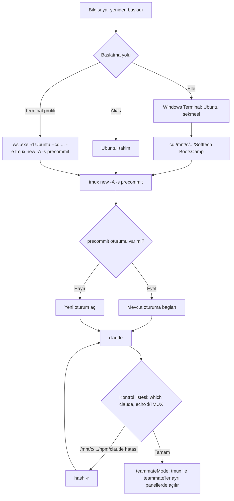

# Sprint 3

| Alan | Değer |
|---|---|
| Tarih | 2026-11-09 11:55 |
| Branch | master |
| Yazar | Azad_ |
| Review kararı | ⚠️ DÜZELTMELERLE COMMIT EDİLEBİLİR (Kritik 0, Yüksek 0, Orta 2, Düşük/Bilgi 5) |

## 1. Özet
Bu commit eğitim notlarını derslere göre klasörlere ayırıyor. Eski düz yapıdaki `Egitim Notlari/` içeriği kayıpsız olarak (`R100`) `Egitim Notlari/LESSON_I/` altına taşındı. İkinci ders için de yeni bir `Egitim Notlari/LESSON_II/` klasörü açıldı; içinde Single Agent notu ve bir slayt görseli var. `General Documents/WSL.md` dosyasına "Her bilgisayar açılışında başlatma" rehberi eklendi. Rehber WSL + tmux + Claude Code oturumunun üç farklı yolla yeniden açılmasını anlatıyor. `.claude/settings.json` dosyasına proje düzeyinde `"teammateMode": "tmux"` ayarı eklendi. Ayrıca önceki commit'te dışarıda kalan `Docs/Sprint_2.md` de bu commit'e dahil edildi. Kaynak kod olmadığı için build ya da test etkisi yok.

## 2. Değişen Dosyalar
| Durum | Dosya | Açıklama |
|---|---|---|
| Değiştirildi | `.claude/settings.json` | `"teammateMode": "tmux"` anahtarı eklendi (+1) |
| Değiştirildi | `General Documents/WSL.md` | "Her bilgisayar açılışında başlatma" bölümü eklendi (+54 / -1; değişen tek eski satır sondaki newline eksikliği yüzünden) |
| Taşındı (R100) | `Egitim Notlari/EgitimNotları.md` → `Egitim Notlari/LESSON_I/EgitimNotları.md` | 1. ders notu, içerik birebir aynı |
| Taşındı (R100) | `Egitim Notlari/Core_Components_of_Agent.png` → `LESSON_I/` | Birebir aynı |
| Taşındı (R100) | `Egitim Notlari/HowWorksAgent.png` → `LESSON_I/` | Birebir aynı |
| Taşındı (R100) | `Egitim Notlari/OtonomiLevel.png` → `LESSON_I/` | Birebir aynı |
| Taşındı (R100) | `Egitim Notlari/Tool.png` → `LESSON_I/` | Birebir aynı |
| Taşındı (R100) | `Egitim Notlari/ToolCallWorkflow.png` → `LESSON_I/` | Birebir aynı |
| Taşındı (R100) | `Egitim Notlari/ToolDesc.png` → `LESSON_I/` | Birebir aynı |
| Eklendi | `Egitim Notlari/LESSON_II/EgitimNotları_II.md` | 2. ders notu (taslak): Single Agent, Tool Registry, Guardrails, Tool Executer, Memory |
| Eklendi | `Egitim Notlari/LESSON_II/SingleAgent.png` | Single Agent mimari slaytı (~95 KB) |
| Eklendi | `Docs/Sprint_2.md` | Önceki commit'in (b6aa7be) sprint dokümanı, daha önce commit dışında kalmıştı |
| Eklendi | `Docs/Sprint_3.md` | Bu doküman |

## 3. Detaylı Değişiklik Açıklamaları

### 3.1 `Egitim Notlari/` klasör yapısı: ders bazlı ayrım
- **Ne değişti:** Önceden tüm notlar ve görseller doğrudan `Egitim Notlari/` altındaydı. Artık her dersin kendi klasörü var:
  ```
  Egitim Notlari/
  ├── LESSON_I/
  │   ├── EgitimNotları.md
  │   ├── Core_Components_of_Agent.png
  │   ├── HowWorksAgent.png
  │   ├── OtonomiLevel.png
  │   ├── Tool.png
  │   ├── ToolCallWorkflow.png
  │   └── ToolDesc.png
  └── LESSON_II/
      ├── EgitimNotları_II.md
      └── SingleAgent.png
  ```
- **Neden:** İkinci dersin notları eklenirken her dersin notunu ve görsellerini bir arada tutmak.
- **Nasıl çalışıyor:** Git yedi dosyanın hepsini `R100` (yüzde 100 benzerlikle rename) olarak algılıyor, yani içerikler birebir aynı ve dosya geçmişi korunuyor. Not dosyası görsellere göreli yolla (`` vb.) bağlı. Görseller notla birlikte taşındığı için linkler kırılmadı.
- **Etkilediği yerler:** Eski yolu anan tek yer `Docs/Sprint_2.md`. Bu doküman tarihsel kayıt olduğu için güncellenmedi; bu commit'ten sonra doğru konum `Egitim Notlari/LESSON_I/`.

### 3.2 `Egitim Notlari/LESSON_II/EgitimNotları_II.md`: 2. ders notu
- **Ne değişti:** Yeni dosya. İçeriği:
  - İlk satırda görsel: ``. Link diskteki dosyaya çözülüyor.
  - "Ilk agent yaratımı" başlığı.
  - **Single Agent** tanımı: "Görev yönetiminin tek bir mekanizmadan geçtiği bir yapı".
  - Alt maddeler: **Tool Registry** (tool seçimi), **Guardrails**, **Tool Executer** (örnekler: Order Service / Inventory API / Return Service) ve içi henüz boş bir **Memory** başlığı.
- **Neden:** 2. dersin (tek agent mimarisi) notlarını almaya başlamak.
- **Nasıl çalışıyor:** Düz metin, girintili madde yapısında yazılmış; Markdown başlığı kullanılmıyor. Dosya sonunda newline yok.
- **Gözlem:** Not taslak hâlinde, "Memory :" başlığında bitiyor. Önceki revizyonda raporlanan `SingleAgent.png.png` kırık linki staged hâlde **düzeltilmiş**.

### 3.3 `General Documents/WSL.md`: "Her bilgisayar açılışında başlatma" bölümü
- **Ne değişti:** Dosyanın sonuna yeni bir bölüm eklendi. Mevcut kurulum adımları (1-4) değişmedi.
- **Neden:** Bilgisayar yeniden başlayınca WSL ve tmux oturumları kapanıyor. Kurulumu tekrarlamadan agent team ortamına hızlıca dönebilmek için.
- **Nasıl çalışıyor:** Bölüm üç başlatma yolu anlatıyor. Üçü de aynı komutta buluşuyor: `tmux new -A -s precommit`. `-A` bayrağı, `precommit` oturumu varsa ona bağlanıyor, yoksa yenisini açıyor.
  - **Elle başlatma:** Windows Terminal'den Ubuntu sekmesi açılır, proje dizinine `cd` yapılır, `tmux new -A -s precommit` ve ardından `claude` çalıştırılır.
  - **Alias:** `~/.bashrc` dosyasına `takim` adında bir alias eklenir. Alias, proje dizinine geçip tmux oturumunu açıyor; ardından `claude` yazılır.
  - **Windows Terminal profili:** `wsl.exe -d Ubuntu --cd "<repo-dizini>" -e tmux new -A -s precommit` komutuyla yeni bir profil oluşturulur ve tek tıkla açılır.
  - **Kontrol listesi:** `which claude` komutunun Linux sürümünü (`~/.local/bin/claude`) göstermesi, `echo $TMUX` çıktısının boş olmaması ve başlıkta `/mnt/c/...` yolunun görünmesi. `claude` Windows'taki npm yolunu bulursa `hash -r` öneriliyor.
- **Sorunlu kısım:** Dosyanın sonunda (satır 90-99) sohbetten kopyalanmış bir asistan yanıtı kalmış ("Dosyanın kendisinde de düzeltilmesi gereken iki yer var…"). Burada önerilen iki düzeltme (3. adımdaki `settings.json` komutuna `CLAUDE_CODE_EXPERIMENTAL_AGENT_TEAMS` eklenmesi ve PATH adımı) ilgili yerlere uygulanmamış. Ayrıca bu satırlardaki komutlar girintisiz olduğu için düz metin olarak görünüyor. Ayrıntılar 6. bölümde.
- **Etkilediği yerler:** Yalnızca geliştirici kurulum rehberi. Yeni bölüm `precommit` oturum adını kullanıyor; eski 4. adım ise `takim` adını kullanıyor (bkz. 6. bölüm).

### 3.4 `.claude/settings.json`: `teammateMode`
- **Ne değişti:** Kök seviyeye, `env` ile `hooks` arasına `"teammateMode": "tmux"` eklendi.
- **Neden:** WSL.md'de anlatılan "her agent'a ayrı tmux paneli" kurulumunu proje düzeyinde sabitlemek. Önceden WSL.md'deki talimata göre bu ayar yalnızca kullanıcı düzeyindeki `~/.claude/settings.json` dosyasına yazılıyordu.
- **Nasıl çalışıyor:** `CLAUDE_CODE_EXPERIMENTAL_AGENT_TEAMS=1` ile açılan agent team modunda, `precommit-lead`'in başlattığı `reviewer` ve `documenter` teammate'leri tmux'ta ayrı panellerde açılır. `permissions` ve `hooks` tanımları değişmedi.
- **Etkilediği yerler:** Bu depoda Claude Code çalıştıran herkes. tmux olmayan ortamlarda (ör. Windows PowerShell) bu ayarın nasıl davrandığı **doğrulanması gerekiyor**.

### 3.5 `Docs/Sprint_2.md` ve sprint numarası
- **Durum:** `Docs/Sprint_2.md` önceki commit'i (b6aa7be "doc güncelleme.") anlatıyor ama o commit'e girmemişti. Bu commit'le birlikte stage edildi ve geçmiş tamamlanmış oluyor.
- **Sprint numarası:** `N = git rev-list --count HEAD + 1 = 2 + 1 = 3`.

## 4. Akış Diyagramları

### 4.1 Bilgisayar açılışında agent team ortamını başlatma (`WSL.md`)
WSL.md'ye eklenen bölüme göre üç başlatma yolu da aynı tmux komutunda buluşuyor:



Diğer değişiklikler (klasör taşıma, tek satırlık yapılandırma) için diyagram gerekmedi. Yeni klasör yapısı 3.1'de ağaç olarak gösterildi.

## 5. Test Sonuçları
- **Sonuç:** 0 geçti / 0 başarısız / 0 atlandı. Test paketi çalıştırılmadı, çünkü çalıştırılabilir kod yok.
- **Yazılan testler:** Yok. Değişikliklerde çalıştırılabilir kod olmadığı için yazılacak bir test de yok.
- **Elle yapılan doğrulamalar (reviewer):**

| Senaryo | Sonuç |
|---|---|
| Taşınan 7 dosyanın içeriği aynı mı? | ✅ Hepsi `R100`, içerik birebir aynı |
| `LESSON_I` ve `LESSON_II` görsel linkleri diskteki dosyalara çözülüyor mu? | ✅ Hepsi çözülüyor |
| `.claude/settings.json` geçerli JSON mu? | ✅ Yeni satırdan sonraki virgül doğru |

- **Kapsanmayan senaryolar:** Projede `teammateMode: "tmux"` ayarlıyken tmux olmayan bir ortamda (Windows PowerShell) Claude Code'un nasıl davrandığı. Doğrulanması gerekiyor.

## 6. Tasarım ve SOLID Değerlendirmesi
Kod olmadığı için SOLID burada uygulanmıyor. Reviewer'ın doküman kalitesi bulguları:

| Seviye | Dosya:Satır | Sorun | Öneri |
|---|---|---|---|
| **Orta** | `Docs/Sprint_3.md:8, 11, 17, 62, 70, 95-96, 106-107, 134-135` | **Doküman güncel değil, staged içerikle çelişiyor.** (1) WSL.md için "yalnızca LF→CRLF değişikliği, metin aynı" yazıyor. Oysa staged diff WSL.md'ye 55 satırlık yeni içerik ekliyor. (2) `SingleAgent.png.png` kırık link bulgusu "Orta" olarak raporlanmış ve karar buna göre verilmiş. Ama staged `EgitimNotları_II.md:1` artık doğru. Sonuç olarak bulgu sayıları ve karar satırı yanlış. | Sprint_3.md'yi staged hâle göre yeniden üretin ya da düzeltin. **Durum: Bu revizyonda giderildi** (bkz. 9. bölüm). |
| **Orta** | `General Documents/WSL.md:90-99` | **Sohbetten kopyalanmış metin dokümana girmiş.** "Dosyanın kendisinde de düzeltilmesi gereken iki yer var…", "Hangisini kullanacaksan … değiştirebilirsin" gibi bir asistan yanıtına ait cümleler var. Önerilen düzeltmeler (satır 31'e `CLAUDE_CODE_EXPERIMENTAL_AGENT_TEAMS` eklenmesi, PATH adımı) kendi yerlerine uygulanmamış, dosyanın sonuna not olarak bırakılmış. Kod blokları girintisiz olduğu için düz metin olarak görünüyor. | Satır 31'deki komutu düzeltilmiş hâliyle değiştirin. PATH adımını 2. adımdan sonra ekleyin. 90-99 arasını silin. |
| Düşük | `General Documents/WSL.md:35, 46` ve `55-76` | Oturum adı tutarsız. Eski bölüm `takim` oturumunu kullanıyor, yeni bölüm `precommit`. Alias'ın adı da `takim`, bu da oturum adıyla karıştırılabilir. | Tek bir oturum adı seçin ve her yerde onu kullanın. |
| Düşük | `General Documents/WSL.md:31, 95` | `echo '...' > ~/.claude/settings.json` mevcut kullanıcı ayar dosyasının üzerine yazar; varsa önceki ayarlar kaybolur. | Komutun öncesine "dosya varsa elle düzenleyin" uyarısı ekleyin ya da yedek alma adımı koyun (`cp ~/.claude/settings.json{,.bak}`). |
| Düşük | `Egitim Notlari/LESSON_II/EgitimNotları_II.md:3-15` | Not yarım kalmış ("Memory :" başlığıyla bitiyor). Yazım hataları var: "Örnğ", "Executer" (doğrusu "Executor"). | Ders notu tamamlanınca güncellenebilir. Commit'i engellemez. |
| Bilgi | `General Documents/WSL.md` (son satır) | Dosya sonunda newline yok. | Editörde "insert final newline" ayarını açın. |

**Reviewer'ın iyileştirme önerileri:**
- `.gitattributes` dosyasına `*.md text eol=lf` ve `*.png binary` ekleyin. Böylece CRLF/LF gürültüsü bundan sonra oluşmaz.
- Sprint dokümanları hook ile otomatik üretiliyorsa bunu stage işleminin son adımı olarak çalıştırın. Bu commit'teki gibi dokümanla içeriğin birbirinden kopması böylece önlenir.

**İyi yapılanlar:**
- Eğitim notları ders bazında klasörlere ayrılmış. Taşıma kayıpsız, linkler korunmuş.
- Önceki incelemede bulunan kırık görsel linki düzeltilmiş ve anlamlı bir alt text eklenmiş.
- WSL.md'ye eklenen başlatma rehberi (`tmux new -A`, alias, Windows Terminal profili, kontrol listesi) pratik ve kullanışlı.
- Diff'te hiçbir sır ya da kimlik bilgisi yok.

## 7. Güvenlik Değerlendirmesi
| Seviye | Dosya:Satır | Sorun | Öneri |
|---|---|---|---|
| Bilgi | `General Documents/WSL.md:57, 67, 76` | Yeni satırlarda yerel Windows kullanıcı adı geçiyor (`C:\Users\<kullanıcı>\...`). Satır 36'da da aynı yol zaten vardı. Sır değil, ama depo herkese açılırsa kullanıcı adı görünür. | Depo public olacaksa `<repo-dizini>` gibi bir yer tutucu kullanın. |
| Bilgi | `.claude/settings.json:32` | `"teammateMode": "tmux"` proje düzeyinde ayarlanmış. Güvenlik riski yok, ancak depoyu klonlayan herkesi tmux'a zorlar. | Kişisel tercihse `.claude/settings.local.json` ya da `~/.claude/settings.json` dosyasına taşıyın. |

- **Gizli bilgi taraması:** `password|secret|apikey|token|connectionstring|bearer|sk-` kalıpları arandı. Gerçek bir sır bulunmadı; eşleşmelerin hepsi Sprint dokümanlarındaki tarama açıklamalarından geliyor.
- **Bağımlılık:** Yeni bağımlılık eklenmedi.

## 8. Açık Konular ve Teknik Borç
- **WSL.md'de sohbet artığı (Orta):** Satır 90-99 silinmeli. Buradaki iki düzeltme (3. adımdaki `settings.json` komutuna `CLAUDE_CODE_EXPERIMENTAL_AGENT_TEAMS` eklenmesi ve 2. adımdan sonra PATH adımı) ilgili yerlere uygulanmalı.
- **Oturum adı tutarsızlığı (Düşük):** WSL.md'de `takim` ve `precommit` oturum adları birlikte kullanılıyor; alias adı da `takim`. Tek bir ada karar verilmeli.
- **`settings.json` üzerine yazma riski (Düşük):** WSL.md'deki `echo ... > ~/.claude/settings.json` komutu için uyarı ya da yedek alma adımı eklenmeli.
- **Yarım LESSON_II notu (Düşük):** `Memory` bölümü boş, "Örnğ" ve "Executer" yazım hataları var.
- **`teammateMode` kapsamı (Bilgi):** Ayar proje düzeyinde. Kişisel tercihse `settings.local.json` ya da `~/.claude/settings.json` dosyasına taşınmalı. tmux olmayan ortamlardaki davranış doğrulanmadı.
- **Yerel kullanıcı yolu (Bilgi):** WSL.md'de Windows kullanıcı adı geçiyor. Depo herkese açılacaksa yer tutucu kullanılmalı.
- **Dosya sonu newline (Bilgi):** WSL.md'nin sonunda newline yok.
- **`.gitattributes` (öneri):** `*.md text eol=lf` ve `*.png binary` kuralları eklenmeli.
- **Sprint dokümanı zamanlaması (öneri):** Doküman üretimi stage işleminin son adımı olarak çalıştırılmalı. Bu commit'te `Sprint_3.md` ilk kez yazıldıktan sonra içerik değişti ve doküman güncelliğini yitirdi.
- **Not:** `Sprint_3.md` bu revizyonda çalışma ağacında güncellendi. Staged sürüm hâlâ eski revizyon; commit'e güncel hâlin girmesi için yeniden stage edilmesi gerekiyor (hook bunu `git add` ile yapıyorsa ek işlem gerekmez, doğrulanması gerekiyor).

## 9. Revizyon Geçmişi
| Tarih | Açıklama |
|---|---|
| 2026-11-09 11:40 | Taslak: 1–4. bölümler yazıldı (klasör yeniden düzenlemesi, LESSON_II notu, `teammateMode`, satır sonu değişiklikleri). |
| 2026-11-09 11:42 | Reviewer raporu işlendi: 5–8. bölümler dolduruldu, review kararı ⚠️ olarak güncellendi. |
| 2026-11-09 11:55 | Doküman staged hâle göre yeniden yazıldı. Taşımalar `R100` olarak düzeltildi; CRLF anlatımı kaldırıldı. WSL.md'ye eklenen "Her bilgisayar açılışında başlatma" bölümü anlatıldı. Kırık link bulgusu "düzeltildi" olarak işaretlendi. `Sprint_2.md` dahil edildi olarak güncellendi. Yeni reviewer raporu işlendi (Orta 2, Düşük/Bilgi 5). Başlatma akışı için flowchart eklendi. |
