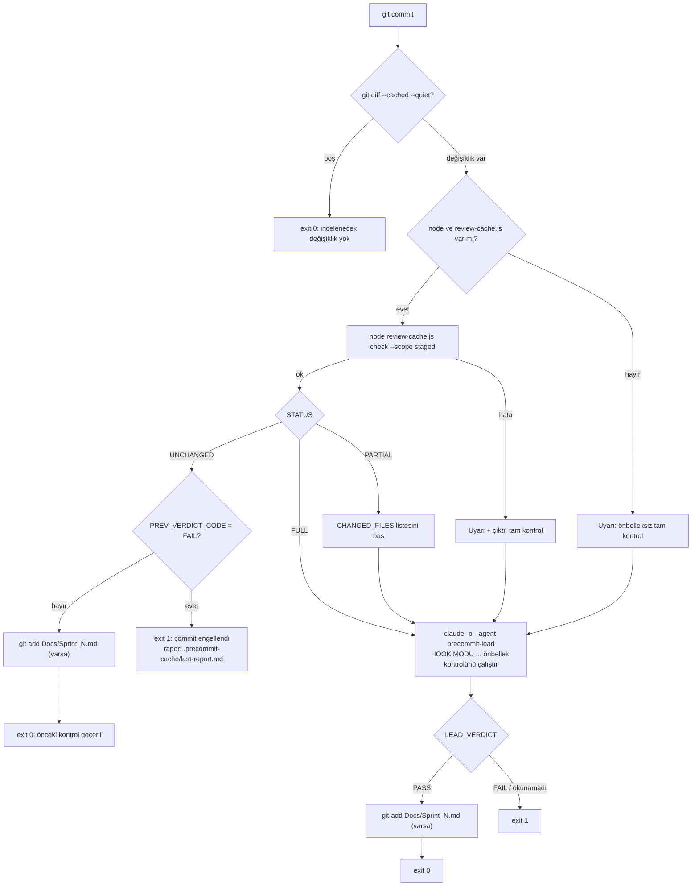
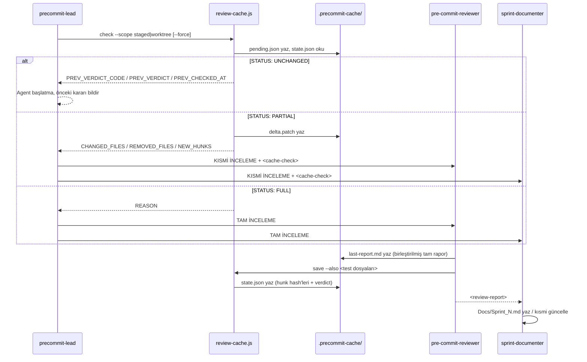
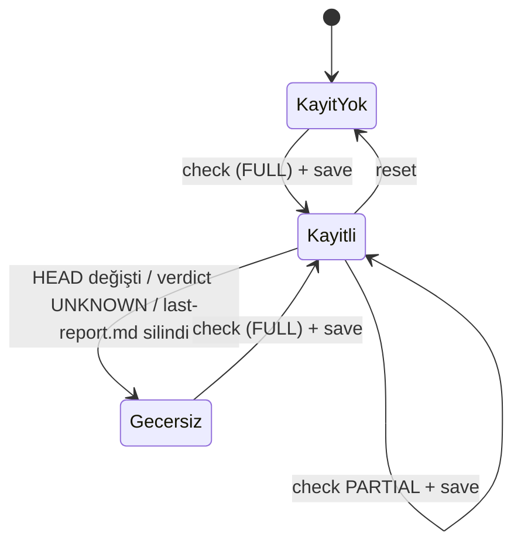

# Sprint 4

| Alan | Değer |
|---|---|
| Tarih | 2026-11-09 13:43 (ilk taslak), son güncelleme 2026-11-09 |
| Branch | master |
| Yazar | Azad_ |
| Review kararı | ⚠️ DÜZELTMELERLE COMMIT EDİLEBİLİR (Kritik 0, Yüksek 0, Orta 1, Düşük/Bilgi 5) |

## 1. Özet
Bu değişiklik pre-commit inceleme akışına **hunk bazlı bir önbellek** ekliyor. Son incelemeden bu yana diff değişmediyse agent'lar (reviewer ve documenter) tekrar çalışmıyor. Diff'in yalnızca bir kısmı değiştiyse sadece yeni ya da değişen hunk'lar inceleniyor. Önbellek mantığı yeni `.claude/hooks/review-cache.js` betiğinde (`check` / `save` / `reset` komutları). `.githooks/pre-commit` hook'u ve üç agent tanımı (`precommit-lead`, `pre-commit-reviewer`, `sprint-documenter`) bu betiği kullanacak şekilde güncellendi ve yeni "kısmi inceleme" akışı tanımlandı. Ayrıca `pre-commit-reviewer` agent'ının modeli `sonnet` olarak sabitlendi.

## 2. Değişen Dosyalar
Kapsam: staged değişiklikler (`git diff --cached`).

| Durum | Dosya | Açıklama |
|---|---|---|
| Eklendi | `.claude/hooks/review-cache.js` | Hunk bazlı inceleme önbelleği; `check`, `save`, `reset` komutları (327 satır, Node.js, yalnızca çekirdek modüller) |
| Değiştirildi | `.githooks/pre-commit` | Agent'ları çağırmadan önce `review-cache.js check --scope staged` çalıştırıyor; `UNCHANGED` / `PARTIAL` / `FULL` durumuna göre dallanıyor |
| Değiştirildi | `.claude/agents/precommit-lead.md` | Ön kontrole 4. adım olarak önbellek kontrolü eklendi; önbellek durumu teammate/alt agent prompt'larına iletiliyor |
| Değiştirildi | `.claude/agents/pre-commit-reviewer.md` | Yeni "9. Önbellek: kısmi inceleme ve kayıt" bölümü; yazma izni `.precommit-cache/last-report.md` ile genişletildi; `model: sonnet` |
| Değiştirildi | `.claude/agents/sprint-documenter.md` | Yeni "8. Kısmi güncelleme" bölümü |
| Eklendi | `Docs/Sprint_4.md` | Bu doküman (önbellek hash setinden hariç tutulur) |

Silinen dosya yok.

> Not: Bu dokümanın önceki taslağında working tree kapsamında görünen `Docs/Sprint_3.md` elle düzenlemesi ve üç not dosyasındaki LF → CRLF dönüşümü (`Egitim Notlari/LESSON_I/EgitimNotları.md`, `Egitim Notlari/LESSON_II/EgitimNotları_II.md`, `General Documents/WSL.md`) bu commit'te **stage edilmemiş**. Bu yüzden bu sprintin kapsamında değiller (bkz. Bölüm 8).

## 3. Detaylı Değişiklik Açıklamaları

### 3.1 `.claude/hooks/review-cache.js`: hunk bazlı inceleme önbelleği
- **Ne değişti:** Yeni bir Node.js betiği eklendi. Yalnızca `fs`, `path`, `crypto` ve `child_process.spawnSync` kullanıyor. Durumunu depo kökündeki `.precommit-cache/` klasöründe tutuyor. Klasör ilk kullanımda oluşturuluyor ve içine `*` içeren bir `.gitignore` yazılıyor. Böylece önbellek depoya girmiyor.
- **Neden:** Commit hook'u ve etkileşimli takım akışı her çalıştırmada iki agent'ı baştan başlatıyordu ve bu dakikalar süren bir iş. Aynı diff için ikinci commit denemesinde ya da küçük bir düzeltmeden sonra tüm incelemeyi tekrarlamak gereksiz.
- **Nasıl çalışıyor:**
  - **Kimlik (hash):** `parseFilePatch()` her dosyanın `-U0` patch'ini başlık ve hunk listesine ayırıyor. Her hunk `sha256(dosya yolu + "\0hunk\0" + hunk gövdesi)` ile hash'leniyor (ilk 24 hex karakter). `@@` satırı (satır numaraları) hash'e girmiyor. Üstüne satır eklendiği için kayan ama içeriği aynı kalan bir hunk "değişmedi" sayılıyor. Metin dosyalarında `index` satırı atılıyor. Binary dosyalarda ve mode/rename gibi durumlarda başlıktaki meta satırları ayrı bir `meta` entity olarak hash'leniyor.
  - **Diff kaynağı (`collectDiff`):** `staged` kapsamında `git diff --cached`, `worktree` kapsamında `git diff HEAD` (HEAD yoksa `git diff`) kullanılıyor. Seçenekler: `-M --no-color --no-ext-diff --no-textconv`, `core.quotepath=false`. Diff her zaman HEAD'e göre alındığı için working tree'de incelenip sonra stage edilen değişiklik hook'ta yeniden incelenmiyor. `git diff HEAD` untracked dosyaları kapsamaz; bu yüzden `worktree` kapsamında untracked dosyalar hash setine girmez (bkz. Bölüm 8).
  - **Hariç tutma:** O anki sprint dokümanı (`Docs/Sprint_{count+1}.md`, `headInfo()` ile hesaplanıyor) hash setinden çıkarılıyor. Böylece documenter'ın yazdığı doküman diff'i "değişmiş" göstermiyor.
  - **`check [--scope staged|worktree] [--force]`:** Güncel entity listesini `pending.json`'a yazıyor ve `state.json` ile karşılaştırıyor. Aynı içerikli birden fazla hunk olabileceği için karşılaştırma multiset olarak yapılıyor. Çıktı `STATUS:` satırıyla başlıyor:
    - `FULL`: diff boş; `--force` / `PRECOMMIT_FORCE=1`; önceki kayıt yok ya da sürüm uyuşmuyor; `HEAD` değişmiş; `last-report.md` yok; önceki karar `UNKNOWN`; ya da diff aynı ama sprint dokümanı eksik ve önceki karar FAIL değil.
    - `UNCHANGED`: eklenen ve çıkan hunk yok.
    - `PARTIAL`: yeni hunk'lar dosya başlığıyla birlikte `.precommit-cache/delta.patch` dosyasına yazılıyor. Çıktıda `NEW_HUNKS`, `CHANGED_FILES`, varsa `REMOVED_HUNKS` / `REMOVED_FILES` satırları yer alıyor. Sprint dokümanı yoksa `NOTE: ... bulunamadı` satırı ekleniyor.
    - `UNCHANGED` ve `PARTIAL` durumlarında `PREV_VERDICT_CODE`, `PREV_VERDICT`, `PREV_REPORT`, `PREV_CHECKED_AT` satırları da basılıyor.
  - **`save [--also <dosya>...]`:** `pending.json` ve `last-report.md` mevcut olmalı, `HEAD` de `check`'ten beri değişmemiş olmalı. Aksi halde çıkış kodu 1. `verdictFromReport()` rapordaki ilk `Karar:` satırından kararı çıkarıyor (`❌` / `COMMIT EDİLMEMELİ` → `FAIL`, `⚠` / `DÜZELTMELERLE` → `WARN`, `✅` / `COMMIT EDİLEBİLİR` → `PASS`, hiçbiri değilse `UNKNOWN`). `--also` ile verilen test dosyalarının o anki hali de `collectAlso()` ile incelenmiş sayılıyor: izlenen dosya için `git diff HEAD`, izlenmeyen dosya için `git diff --no-index /dev/null <dosya>`. Sonuç `state.json`'a yazılıyor.
  - **`reset`:** `state.json`, `pending.json` ve `delta.patch` dosyalarını siliyor (`last-report.md` silinmiyor). Sonraki kontrol `FULL` oluyor.
  - Herhangi bir hata `review-cache hata: ...` mesajı ve çıkış kodu 1 ile sonuçlanıyor.
- **Etkilediği yerler:** `.githooks/pre-commit`, `precommit-lead`, `pre-commit-reviewer`, `sprint-documenter` agent tanımları.

### 3.2 `.githooks/pre-commit`: önbellekli hook akışı
- **Ne değişti:** Agent'lar çağrılmadan önce önbellek kontrolü yapılıyor. Sprint doküman yolu (`N`, `DOC`) baştan bir kez hesaplanıyor.
- **Nasıl çalışıyor:**
  - `node` ve `review-cache.js` varsa `check --scope staged` çalışıyor. Çıktıdan `STATUS`, `PREV_VERDICT_CODE`, `PREV_VERDICT`, `PREV_CHECKED_AT` değerleri `sed` ile alınıyor. Komut hata verirse ya da node/betik yoksa uyarı basılıp tam kontrole geçiliyor.
  - `UNCHANGED` ve önceki karar `FAIL` ise commit engelleniyor (`exit 1`). Kullanıcı rapora ve `PRECOMMIT_FORCE=1` seçeneğine yönlendiriliyor.
  - `UNCHANGED` ve önceki karar FAIL değilse varsa `Docs/Sprint_N.md` stage ediliyor ve agent çalıştırılmadan commit devam ediyor (`exit 0`).
  - `PARTIAL` durumunda `CHANGED_FILES:` satırından sonrası ekrana basılıp agent akışı çalıştırılıyor. `FULL` durumunda eskisi gibi tam kontrol mesajı veriliyor.
  - `claude -p --agent precommit-lead --permission-mode acceptEdits` prompt'una "Kapsam: staged. Önce önbellek kontrolünü (review-cache.js check --scope staged) çalıştır..." talimatı eklendi. Hook kendi `check` çıktısını prompt'a geçirmiyor; lider kontrolü kendisi yeniden çalıştırıyor.
  - Dosyanın başına kullanım notları eklendi: `PRECOMMIT_FORCE=1 git commit ...` (önbelleği yok say) ve `node .claude/hooks/review-cache.js reset` (önbelleği sıfırla).
- **Etkilediği yerler:** `core.hooksPath=.githooks` ayarlı her commit.
- **Dikkat:** Reviewer, hook modunda agent'ların `node .claude/hooks/review-cache.js` komutlarını Bash ile çalıştırabilmesinin onaya bağlı olduğunu Orta seviyede raporladı. Bu inceleme sırasında `check` gerçekten onay istedi (bkz. Bölüm 6 ve 8).

### 3.3 `.claude/agents/precommit-lead.md`
- **Ne değişti:** Ön kontrole 4. adım eklendi: `node .claude/hooks/review-cache.js check --scope staged|worktree`. Kullanıcı "baştan / tam kontrol" derse komuta `--force` ekleniyor.
  - `UNCHANGED`: agent başlatılmıyor. Takım modunda kullanıcıya önceki karar ve rapor yolu bildiriliyor. Hook modunda `PREV_VERDICT_CODE` PASS/WARN ise `LEAD_VERDICT: PASS`, FAIL ise `LEAD_VERDICT: FAIL` yazılıyor.
  - `PARTIAL`: teammate ve alt agent prompt'larına `KISMİ İNCELEME` ve `<cache-check>` etiketleri içinde check çıktısının tamamı ekleniyor.
  - `FULL`: prompt'lara `TAM İNCELEME` yazılıyor. Komut hata verirse tam akışa geçiliyor.
- Teammate'lere iletilecek bilgilere "önbellek durumu" eklendi. Hook modu adımları önbellek durumunu iletecek şekilde güncellendi.
- "Dosya düzenleme yapma" kuralına tek bir istisna eklendi: `review-cache.js check` (yalnızca `.precommit-cache/` altına yazar).

### 3.4 `.claude/agents/pre-commit-reviewer.md`
- **Ne değişti:** "9. Önbellek: kısmi inceleme ve kayıt" bölümü eklendi.
  - **Kısmi inceleme:** `delta.patch` ve `last-report.md` okunuyor. Yalnızca delta hunk'ları inceleniyor. Değişmemiş dosyalardaki önceki bulgular aynen taşınıyor. `CHANGED_FILES` / `REMOVED_FILES` içindeki bulgular yeniden değerlendiriliyor ve çözülenler "Önceki rapordan çözülenler" listesine yazılıyor. Önceki Kritik/Yüksek bulguların çözülüp çözülmediği mutlaka doğrulanıyor. Çıktı **birleştirilmiş tam rapor** oluyor ve `İncelenen dosyalar` satırına `Kısmi inceleme: <CHANGED_FILES>` yazılıyor.
  - **Kayıt (tüm modlarda):** Rapor `.precommit-cache/last-report.md` dosyasına yazılıyor, ardından `review-cache.js save --also <test dosyaları>` çalıştırılıyor. Hata olursa rapora not düşülüyor; karar değişmiyor.
- Yazma izni test dosyalarına ek olarak `.precommit-cache/last-report.md` ile genişletildi.
- Frontmatter'da `model: sonnet` kullanılıyor. Reviewer bu değeri `inherit` yerine `sonnet` yapılmış bir değişiklik olarak raporladı. Önceki değer bu oturumda diff ile doğrulanamadı.

### 3.5 `.claude/agents/sprint-documenter.md`
- **Ne değişti:** "8. Kısmi güncelleme" bölümü eklendi. `KISMİ İNCELEME` geldiğinde mevcut `Docs/Sprint_{N}.md` baştan yazılmıyor. `delta.patch`'e göre yalnızca 2–4. bölümler güncelleniyor, 5–7. bölümler yeni (birleştirilmiş) raporla değiştiriliyor ve Revizyon Geçmişi'ne `Kısmi güncelleme: <dosyalar>` satırı ekleniyor. Doküman yoksa (`NOTE: ... bulunamadı`) normal tam akış uygulanıyor.

## 4. Akış Diyagramları

### 4.1 `.githooks/pre-commit` önbellek kararı (`flowchart`)
Hook'un `review-cache.js check` sonucuna göre nasıl dallandığını gösterir.

### 4.2 Lider, reviewer, documenter ve önbellek etkileşimi (`sequenceDiagram`)
Agent tanımlarına göre bir kontrol turunda `review-cache.js` komutlarının kim tarafından ve hangi sırayla çağrıldığını gösterir.

### 4.3 Önbellek durumu (`stateDiagram-v2`)
`state.json`'ın yaşam döngüsünü ve bir sonraki `check`'in sonucunu gösterir.

## 5. Test Sonuçları
> Kaynak: `pre-commit-reviewer` raporu (HOOK MODU, TAM İNCELEME, staged kapsam). Değiştirilmeden aktarılmıştır.

- **Sonuç: 0 geçti / 0 başarısız / 0 atlandı** (çalıştırılabilir test yok).
- **Yazılan testler:** Yok. Depoda .NET/Node/Java test projesi ve `review-cache.js` için test altyapısı bulunmuyor. Kurala göre test projesi kendiliğinden oluşturulmadı.
- **Build/sözdizimi:** Bash onay gerektirdiği için `node --check` ve `sh -n` çalıştırılamadı. Betikler yalnızca okunarak incelendi. **Sözdizimi doğrulaması yapılmadı, doğrulanması gerekiyor.**

### Önerilen senaryolar (Node `node:test`, geçici git deposunda)
| Senaryo | Beklenen |
|---|---|
| `check`, state yokken | `FULL` |
| `save` sonrası `check`, diff aynı | `UNCHANGED` |
| Bir hunk değiştirilince | `PARTIAL`, `delta.patch` yalnızca yeni hunk'ı içerir |
| Üste satır eklenip içerik aynı kalınca | `UNCHANGED` (satır numarası hash'e girmiyor) |
| Yeni commit sonrası `check` | `FULL` (HEAD değişti) |
| `--force` ve `PRECOMMIT_FORCE=1` | `FULL` |
| `Docs/Sprint_N.md` yokken diff aynı | `FULL` (önceki karar FAIL değilse) |
| Önceki karar `FAIL`, diff aynı | `UNCHANGED` + `PREV_VERDICT_CODE: FAIL`, hook commit'i engeller |
| `verdictFromReport` ile ❌/⚠️/✅/boş satır | FAIL/WARN/PASS/UNKNOWN |
| Aynı içerikli iki hunk, biri silinince | multiset karşılaştırması `removed` üretir |
| Rename ve binary dosya | `meta` entity oluşur |
| `save`, `pending.json` yokken | çıkış kodu 1 |

### Kapsanmayan senaryolar
Yukarıdaki senaryoların tamamı. Ayrıca `pre-commit` shell akışı (UNCHANGED/PARTIAL dalları) için otomatik test yok.

## 6. Tasarım ve SOLID Değerlendirmesi
> Kaynak: `pre-commit-reviewer` raporu. Değiştirilmeden aktarılmıştır.

**Karar:** ⚠️ DÜZELTMELERLE COMMIT EDİLEBİLİR. **Kritik: 0 | Yüksek: 0 | Orta: 1 | Düşük/Bilgi: 5**

**Kritik / Yüksek bulgular:** Yok.

| Seviye | Dosya:Satır | Sorun | Öneri |
|---|---|---|---|
| **Orta** | `.githooks/pre-commit` (claude çağrısı) ve `precommit-lead.md` madde 4 | Akış, hook modunda agent'ların `node .claude/hooks/review-cache.js check/save` komutlarını Bash ile çalıştırmasına dayanıyor. `acceptEdits` Bash komutlarını otomatik onaylamaz. Bu incelemede `check` komutunun onay gerektirdiği görüldü. Sonuç olarak `save` hiç çalışmayabilir, `state.json` yazılmaz ve önbellek sessizce her zaman FULL kalır. Doğrulanması gerekiyor. | `claude -p` çağrısına `--allowedTools "Bash(node .claude/hooks/review-cache.js:*)"` ekle. Ya da hook'un kendisi, agent bittikten sonra `save` çalıştırsın (`last-report.md` zaten yazılıyor). |
| Düşük | `review-cache.js:162-170` | `verdictFromReport`, raporda ilk "Karar:" geçen satırı alıyor. Doldurulmamış şablon satırı (`✅ ... \| ⚠️ ... \| ❌`) FAIL olarak okunur. | Son eşleşmeyi al (`matchAll`) ya da `## Özet` altındaki satırı hedefle. |
| Düşük | `review-cache.js:36-327` | Dosya tek parça. Git erişimi, parse, karşılaştırma ve CLI aynı dosyada. Küçük bir araç için pragmatik olarak kabul edilebilir. | Büyürse modüllere böl. Şimdilik gerek yok. |
| Bilgi | `pre-commit-reviewer.md` frontmatter | `model: inherit` yerine `model: sonnet` yapılmış. Bu bilinçli bir tercih olabilir, ama bu incelemenin kalitesini etkiler. | Niyet buysa sorun yok. |
| Bilgi | `review-cache.js:306-310` | `reset` içindeki boş `catch` kasıtlı (dosya yoksa sorun değil). | Yorum eklenebilir. |

### İyileştirme Önerileri (reviewer)
- Orta bulgudaki izin sorununu çöz; çözülmezse önbellek pratikte çalışmaz.
- `review-cache.js` için küçük bir `node:test` paketi ekle.
- `--also` yollarını repo köküne göre doğrula.

### İyi Yapılanlar (reviewer)
- Hunk içeriği bazlı hash. Satır kaymaları yanlışlıkla yeniden inceleme tetiklemiyor.
- Güvenli varsayılanlar: bilinmeyen karar, HEAD değişimi, rapor yokluğu ve doküman yokluğunda FULL'a düşüyor.
- Önceki FAIL kararı, değişiklik olmadığı sürece commit'i engelliyor.
- `PRECOMMIT_FORCE` ve `reset` ile kaçış yolları var.
- `spawnSync` argüman dizisiyle çağrılıyor, shell enjeksiyonu yok.
- Önbellek klasörü kendi `.gitignore`'unu yazıyor.

## 7. Güvenlik Değerlendirmesi
> Kaynak: `pre-commit-reviewer` raporu. Değiştirilmeden aktarılmıştır.

| Seviye | Dosya:Satır | Sorun | Öneri |
|---|---|---|---|
| Bilgi | `review-cache.js:139-151` | `--also` ile verilen yol repo dışına çıkabilir (`../`). `git diff --no-index` o dosyanın içeriğini hash'lemek için okur. Dışarı veri sızmıyor, yalnızca state'e hash giriyor. | `path.resolve` ile yolun `root` altında kaldığını doğrula. |
| Bilgi | `review-cache.js:204, 299` | `.precommit-cache/state.json` yerel ve doğrulanmamış. Yazma erişimi olan biri sahte state ile incelemeyi atlatabilir. Yerel geliştirici hook'u için kabul edilebilir. | Gerekmez. İsteğe bağlı olarak state'e HMAC eklenebilir. |
| Bilgi | `.githooks/pre-commit` (claude çağrısı) | `--permission-mode acceptEdits` ile non-interaktif çalışılıyor. Bu zaten vardı. Değişiklik önbellekle FAIL durumunu atlamıyor. | Yok. |

Koda gömülü sır yok (kalıp taraması temiz). Yeni bağımlılık yok; yalnızca Node çekirdek modülleri kullanılıyor.

## 8. Açık Konular ve Teknik Borç
Karar ⚠️ olduğu için aşağıdaki bulgular çözülmeden commit edilebilir.

### Orta
| # | Konu | Dosya | Önerilen aksiyon |
|---|---|---|---|
| 1 | Hook modunda `node .claude/hooks/review-cache.js check/save` Bash komutları `acceptEdits` ile otomatik onaylanmıyor. Bu oturumda `check` onay istedi; `save` çalışmazsa önbellek sessizce hep FULL kalır. **Doğrulanması gerekiyor** | `.githooks/pre-commit`, `precommit-lead.md` madde 4 | `claude -p` çağrısına `--allowedTools "Bash(node .claude/hooks/review-cache.js:*)"` eklemek ya da `save`'i agent bittikten sonra hook'un kendisinin çalıştırması |

### Düşük / Bilgi
- `verdictFromReport` ilk `Karar:` satırını alıyor; doldurulmamış şablon satırı FAIL okunur (`review-cache.js:162-170`). Son eşleşmeyi ya da `## Özet` altındaki satırı hedeflemek.
- `review-cache.js` tek dosyada; büyürse modüllere bölmek.
- `--also` yollarını repo köküne sınırlamak (`review-cache.js:139-151`).
- `state.json` için isteğe bağlı HMAC.
- `reset` içindeki kasıtlı boş `catch`'e açıklama yorumu eklemek.
- `pre-commit-reviewer` için `model: sonnet` tercihinin bilinçli olup olmadığını teyit etmek.

### Test ve doğrulama borcu
- `review-cache.js` için `node:test` paketi yok; Bölüm 5'teki senaryoların tamamı kapsanmıyor. `pre-commit` shell akışı için de otomatik test yok.
- `node --check` ve `sh -n` sözdizimi kontrolleri çalıştırılamadı; **doğrulanması gerekiyor**.

### Önbellek kaydı notu (reviewer)
`.precommit-cache/last-report.md` yazımı ve `review-cache.js save` adımı bu oturumda yapılmadı. Yazma ve Bash komutları onay gerektiriyor ve etkileşimsiz modda onay alınamıyor. Rapor kaydedilmediği için bir sonraki kontrol FULL olacak. Bu durum kararı değiştirmiyor.

### Bu commit'in dışında kalan çalışma alanı değişiklikleri
Önceki taslakta working tree kapsamında görünen aşağıdaki değişiklikler stage edilmemiş ve bu incelemede değerlendirilmedi:
- `Docs/Sprint_3.md` taşıma tablosundaki kaynak yolların elle değiştirilmesi. Önceki incelemede kaynak ve hedef yolların aynı göründüğü raporlanmıştı; ne yapılacağı kullanıcıya ait.
- `Egitim Notlari/LESSON_I/EgitimNotları.md`, `Egitim Notlari/LESSON_II/EgitimNotları_II.md`, `General Documents/WSL.md` dosyalarında yalnızca LF → CRLF dönüşümü. Kalıcı çözüm için `.gitattributes` kuralı düşünülebilir.

## 9. Revizyon Geçmişi
| Tarih | Açıklama |
|---|---|
| 2026-11-09 13:43 | İlk taslak: 1–4. bölümler (documenter, review öncesi) |
| 2026-11-09 13:54 | Reviewer raporu (`review-report-2.md`, working tree kapsamı) işlendi: 5–8. bölümler ve karar alanı dolduruldu |
| 2026-11-09 | HOOK MODU, TAM İNCELEME (staged kapsam): Bölüm 1–2 staged dosya listesine göre güncellendi (`Docs/Sprint_3.md` ve EOL dosyaları kapsam dışı), 3.4'e `model: sonnet` eklendi, 5–8. bölümler yeni reviewer raporuyla değiştirildi (Orta 1, Düşük/Bilgi 5) |
