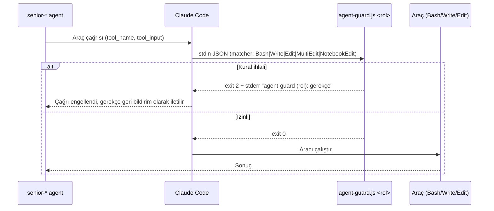
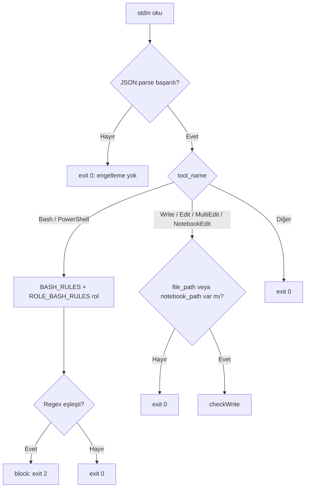
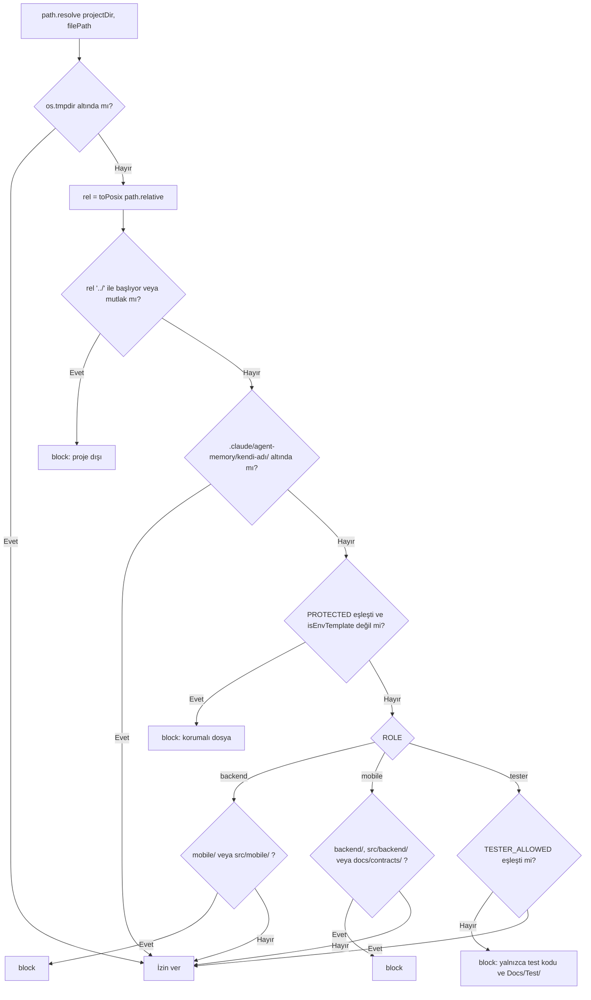
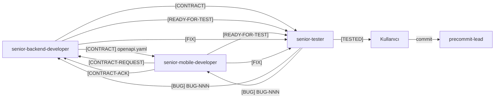

# Sprint 5

| Alan | Değer |
|---|---|
| Tarih | 2026-11-09 15:53 |
| Branch | master |
| Yazar | Azad_ |
| Review kararı | ⚠️ DÜZELTMELERLE COMMIT EDİLEBİLİR (Kritik 0, Yüksek 0, Orta 0, Düşük/Bilgi 5) |

## 1. Özet
Bu değişiklikle projeye üç geliştirme agent'ı ekleniyor: `senior-backend-developer`, `senior-mobile-developer` ve `senior-tester`. Bu agent'lar en az iki ay sürecek çok haftalık bir projede birlikte çalışacak şekilde tasarlandı. Her biri kendi alanının sahibi ve aralarındaki iletişim API sözleşmesi (`Docs/Contracts/openapi.yaml`) ile etiketli mesajlar (`[CONTRACT]`, `[READY-FOR-TEST]`, `[BUG]` vb.) üzerinden yürüyor. Agent'ların `.md` dosyalarındaki "Yetkiler" bölümü yeni `.claude/hooks/agent-guard.js` hook'uyla teknik olarak uygulanıyor. Bu hook bir `PreToolUse` kontrolü yapıyor: tehlikeli Bash komutlarını ve rolün izinli alanı dışındaki dosya yazımlarını `exit 2` ile engelliyor. `.claude/settings.json` dosyasında da iki değişiklik var. `"agent": "precommit-lead"` varsayılan agent ayarı kaldırıldı ve `review-cache.js` için Bash izni eklendi.

## 2. Değişen Dosyalar
Kapsam: staged değişiklikler (`git diff --cached`). Toplam 1115 ekleme, 1 silme.

| Durum | Dosya | Açıklama |
|---|---|---|
| Eklendi | `.claude/agents/senior-backend-developer.md` | Backend agent tanımı (306 satır). Rol sınırları, teknoloji yığını, API/DB/güvenlik standartları, yetkiler, DoD. Hook rolü `backend` |
| Eklendi | `.claude/agents/senior-mobile-developer.md` | Mobile agent tanımı (313 satır). Flutter/RN/Native yığınları, offline davranış, MASVS güvenliği, performans/erişilebilirlik. Hook rolü `mobile` |
| Eklendi | `.claude/agents/senior-tester.md` | Test/QA agent tanımı (346 satır). Test stratejisi, tasarım teknikleri, bug raporlama, regresyon/flaky politikası. Hook rolü `tester` |
| Eklendi | `.claude/hooks/agent-guard.js` | Rol bazlı `PreToolUse` yetki hook'u (149 satır, Node.js, yalnızca `path` ve `os` modülleri) |
| Değiştirildi | `.claude/settings.json` | `"agent": "precommit-lead"` satırı kaldırıldı; `Bash(node .claude/hooks/review-cache.js *)` izni eklendi |

Silinen dosya yok. Review sürecinde yazılan test dosyası yok.

## 3. Detaylı Değişiklik Açıklamaları

### 3.1 `.claude/hooks/agent-guard.js`: rol bazlı yetki kontrolü
- **Ne değişti:** Yeni bir Node.js hook betiği eklendi. Rol, komut satırı argümanından okunuyor (`process.argv[2]`: `backend` | `mobile` | `tester`; argüman yoksa `unknown`). Claude Code araç çağrısını stdin'den JSON olarak gönderiyor. Yasaklı bir işlemde `block()` stderr'e `agent-guard (<rol>): <gerekçe>` yazıyor ve `process.exit(2)` ile çağrıyı engelliyor. Gerekçe mesajı agent'a geri bildirim olarak dönüyor.
- **Neden:** Agent `.md` dosyalarındaki yetki kuralları yalnızca birer talimat. Hook, bu kuralları model davranışından bağımsız olarak teknik düzeyde uyguluyor. Dosyanın başındaki yorumda belirtildiği gibi, hook ile `.md` dosyalarındaki "Yetkiler" bölümü birlikte güncellenmeli.
- **Nasıl çalışıyor:**
  - **Ana akış:** stdin tamamen okunuyor ve `JSON.parse` ediliyor. Parse hatasında hook hiçbir şey engellemeden çıkıyor (fail-open, bkz. Bölüm 7). Proje kökü sırasıyla `CLAUDE_PROJECT_DIR`, `input.cwd` ve `process.cwd()` kaynaklarından alınıyor.
  - **Bash / PowerShell çağrıları:** `tool_input.command`, `BASH_RULES` ile rolün `ROLE_BASH_RULES` listesinin birleşimine karşı sırayla test ediliyor. İlk eşleşmede çağrı engelleniyor ve komutun ilk 200 karakteri mesaja ekleniyor.
  - **`BASH_RULES` (tüm roller):**
    - Depo durumunu değiştiren git komutları: `commit`, `push`, `reset`, `rebase`, `merge`, `cherry-pick`, `revert`, `clean`, `tag`, `filter-branch`, `filter-repo`, `update-ref`, `replace`, `am`, `apply`
    - `git checkout|switch|restore`, `git stash`, `git branch -d/-D/-m/-M/-c/-C`
    - `git config`: negative lookahead ile yalnızca `--get`, `-l`, `--list` ve komutun sonunda duran `user.name` / `user.email` okumaları serbest
    - `--no-verify`
    - Kök, üst dizin, joker, `.git`, `.claude`, `.githooks` ve `Docs` üzerinde özyinelemeli `rm`; `Remove-Item ... -Recurse`
    - `curl|wget|iwr|Invoke-WebRequest ... | sh|bash|pwsh|iex...` (indirilen script'i çalıştırma)
    - Paket yayınlama (`npm publish`, `dotnet nuget push`, `flutter pub publish`, `pod trunk push`)
    - Uzak ortam değişiklikleri (`docker push|login`, `kubectl apply|delete|...`, `helm install|...`, `terraform apply|...`, `az ... create|delete|update`, `aws ... create|delete|...`)
    - Store/uzak build (`fastlane`, `eas submit|build`, `altool`)
    - Veritabanı silme (`dotnet ef database drop`, `DROP DATABASE|SCHEMA`, `TRUNCATE TABLE`)
    - Sistem ayarları (`shutdown`, `Set-ExecutionPolicy`, `setx`, `reg add|delete` vb.)
    - Global araç kurulumu (`npm i -g`, `dotnet tool install -g`, `winget|choco install`)
    - Gizli dosyaları ekrana dökme (`cat|type|Get-Content|head|tail ...` + `.env`, `.pem`, `.pfx`, `.p12`, `.jks`, `.keystore`, `id_rsa`). `.env.example`, `.env.sample` ve `.env.template` bu kuralın dışında.
  - **`ROLE_BASH_RULES.tester`:** Güvenlik tarama araçları (`zap-baseline`, `zap-full-scan`, `zap.sh`, `nikto`, `sqlmap`, `nmap`) engelleniyor. `k6 run` yalnızca `localhost`, `127.0.0.1`, `10.0.2.2` ve `host.docker.internal` dışındaki `http(s)://` hedeflerde engelleniyor.
  - **Write / Edit / MultiEdit / NotebookEdit:** `tool_input.file_path` (ya da `notebook_path`) `checkWrite()` fonksiyonuna veriliyor:
    1. Yol `path.resolve(projectDir, filePath)` ile mutlak hale getiriliyor. OS geçici klasörü altındaki yollar serbest (büyük/küçük harf duyarsız karşılaştırma).
    2. Proje köküne göre göreli yol POSIX biçimine çevriliyor (`toPosix`, Windows `\` → `/`). `../` ile başlayan ya da mutlak kalan yollar "proje dışı" sayılıp engelleniyor.
    3. Rolün kendi hafıza klasörü `.claude/agent-memory/<agent-adı>/` serbest. Bu istisna `PROTECTED` kontrolünden önce uygulanıyor.
    4. `PROTECTED` listesi (küçük harfe çevrilmiş yol üzerinde): `.git/`, `.claude/`, `.githooks/`, `.precommit-cache/`, `docs/sprint_N.md`, `.env` ve `.env.*`, `*.pem|key|pfx|p12|jks|keystore|mobileprovision|p8`, `google-services.json`, `googleservice-info.plist`, `key.properties`, `appsettings.production.json`. `.env.example|sample|template` için ayrı bir `isEnvTemplate` istisnası var.
    5. Rol kuralları: `backend` rolü `mobile/` ya da `src/mobile/` altına yazamıyor. `mobile` rolü `backend/`, `src/backend/` ve `docs/contracts/` altına yazamıyor. `tester` rolü yalnızca `TESTER_ALLOWED` allowlist'ine uyan yollara yazabiliyor: test klasörleri, `*.Tests/` benzeri proje klasörleri, `*.test.*`/`*_spec.*` benzeri dosyalar, `*Tests.cs` benzeri dosyalar, `docs/test/` ve `docs/agents/senior-tester/`.
  - Örnek kural tanımı (veri odaklı tablo yapısı):
    ```js
    const PROTECTED = [
      [/^\.git\//, ".git klasörü"],
      [/^\.claude\//, ".claude yapılandırması (...)"],
      // ...
    ];
    ```
- **Etkilediği yerler:** Yalnızca frontmatter'ında bu hook'u tanımlayan üç yeni agent. `precommit-lead`, `pre-commit-reviewer` ve `sprint-documenter` agent'ları bu hook'u kullanmıyor; `settings.json` içinde de global bir `PreToolUse` kaydı yok.

### 3.2 `.claude/agents/senior-backend-developer.md`
- **Ne değişti:** Yeni agent tanımı eklendi. Frontmatter: `model: claude-opus-5-5`, `memory: project`, `color: blue`, araçlar `Read, Write, Edit, Glob, Grep, Bash, WebFetch, WebSearch, TodoWrite, Skill`. `PreToolUse` hook'u (`matcher: "Bash|Write|Edit|MultiEdit|NotebookEdit"`) `agent-guard.js backend` çalıştırıyor.
- **İçerik (16 bölüm):** Rol ve sorumluluk sınırı (`backend/`, `Docs/Contracts/openapi.yaml`, migration'lar, `Docs/ADR/`), oturum başlangıç protokolü (hafıza → worklog → backlog → git durumu → baseline build/test), varsayılan .NET + Clean Architecture yığını, mimari/kod standartları, contract-first API tasarımı (versiyonlama, breaking change tanımı, status code'lar, idempotency), migration kuralları, OWASP API Top 10 tabanlı güvenlik kontrol listesi, unit/integration/contract test sorumluluğu, iş akışı, yetkiler (Serbest / Onay gerektirir / Yasak), takım iletişim etiketleri, araç kuralları, Definition of Done, yetkinlik matrisi, uzun proje sürekliliği (`WORKLOG.md`, ADR, hafıza, sprint ritmi) ve pre-commit/guard uyumu.
- **Etkilediği yerler:** `precommit-lead` akışı. Agent commit atmıyor; commit öncesi kontrolün `precommit-lead` tarafından yapılacağını kullanıcıya hatırlatıyor.

### 3.3 `.claude/agents/senior-mobile-developer.md`
- **Ne değişti:** Yeni agent tanımı eklendi. Frontmatter backend ile aynı yapıda (`model: claude-opus-5-5`, `color: green`). Hook rolü `mobile`.
- **İçerik:** `mobile/` klasörünün sahipliği; Flutter (varsayılan öneri) / React Native / Native karşılaştırması; feature-first katman yapısı ve tek yönlü veri akışı; mock-first API entegrasyonu, retry/timeout/token refresh kuralları ve offline-first kuyruk; OWASP MASVS tabanlı güvenlik; performans bütçesi, WCAG 2.2 AA erişilebilirlik ve UX kuralları; test anahtarı (`<ekran>_<öğe>`) konvansiyonu ve `Docs/Mobile/TEST_IDS.md`; yetkiler; `[CONTRACT-REQUEST]` / `[CONTRACT-ACK]` etiketleri. Windows ortamında iOS build alınamayacağı ve iOS doğrulamasının macOS gerektirdiği açıkça belirtiliyor.

### 3.4 `.claude/agents/senior-tester.md`
- **Ne değişti:** Yeni agent tanımı eklendi. Frontmatter'da `model: sonnet`, `color: orange`; araç listesinde `WebSearch` yok. Hook rolü `tester`.
- **İçerik:** "Çalıştırmadığın testi geçti sayma" temel ilkesi; risk bazlı test stratejisi ve sahiplik tablosu (unit/integration geliştiricide, API/E2E/performans/güvenlik tester'da); test tasarım teknikleri (denklik sınıfları, sınır değer, karar tablosu, durum geçişi, pairwise, Türkçe karakter gibi hata tahminleri); varsayılan araçlar (xUnit, Playwright, Maestro, k6, axe, ZAP baseline yalnızca onayla); `Docs/Test/bugs/BUG-NNN.md` bug şablonu ve ciddiyet tanımları; regresyon paketleri ve flaky test politikası; rapor türleri (özellik, sprint, release GO/NO-GO); yetkiler; `pre-commit-reviewer` ile görev ayrımı.

### 3.5 `.claude/settings.json`
- **Ne değişti:**
  - `"agent": "precommit-lead"` satırı kaldırıldı.
  - `permissions.allow` listesine `Bash(node .claude/hooks/review-cache.js *)` eklendi.
- **Neden:** Commit mesajı ya da kodda bir gerekçe yok. Varsayılan agent satırının kaldırılması büyük olasılıkla ana oturumun artık yeni geliştirme agent'larıyla da kullanılabilmesi için yapıldı, ancak bu **doğrulanması gerekiyor** (bkz. Bölüm 6 ve 8). `review-cache.js` izni, Sprint 4'te eklenen önbellek betiğinin onay sorulmadan çalıştırılabilmesini sağlıyor.
- **Etkilediği yerler:** Varsayılan agent ayarı olmadığı için Claude Code oturumu artık doğrudan `precommit-lead` ile başlamıyor. Etkileşimli pre-commit akışında lider agent'ın açıkça seçilmesi gerekebilir. `.githooks/pre-commit` hook'unun bu ayara bağımlı olup olmadığı **doğrulanması gerekiyor**.

## 4. Akış Diyagramları

### 4.1 Hook çağrı sırası
Bir geliştirme agent'ı araç çağırdığında Claude Code, agent frontmatter'ındaki `PreToolUse` hook'unu çalıştırıyor.



### 4.2 `agent-guard.js` ana akışı



### 4.3 `checkWrite()` karar akışı



### 4.4 Agent'lar arası çalışma akışı
Agent `.md` dosyalarında tanımlanan mesaj etiketlerine göre özellik geliştirme döngüsü.



## 5. Test Sonuçları
- **Sonuç:** Çalıştırılacak test yok (0 geçti / 0 başarısız / 0 atlandı). Değişiklikler yapılandırma ve agent tanımı niteliğinde; üretim kodu ve build adımı yok.
- **Yazılan testler:** Yok. Repoda test projesi ve test framework'ü bulunmadığı için reviewer test dosyası oluşturmadı.
- **Test edilen senaryolar:** Yok.
- **Kapsanmayan senaryolar (reviewer'ın `agent-guard.js` için önerileri):**

| # | Senaryo | Beklenen |
|---|---|---|
| 1 | `git commit` ve `git push` komutları | Engellenir (exit 2) |
| 2 | `git config user.name` / `git config user.name x` | İlki serbest, ikincisi engellenir |
| 3 | `.env` / `.env.example` yazımı | `.env` engellenir, `.env.example` serbest |
| 4 | Tester rolü: `src/Foo.cs` / `tests/FooTests.cs` | İlki engellenir, ikincisi serbest |
| 5 | Backend rolü: `mobile/` altına yazım | Engellenir |
| 6 | OS geçici klasöründeki dosyalar | Serbest |
| 7 | Bozuk JSON girdisi | Çıkış kodu 0 |

## 6. Tasarım ve SOLID Değerlendirmesi
Reviewer raporundan:

| Seviye | Dosya | Bulgu | Öneri |
|---|---|---|---|
| Olumlu | `agent-guard.js` | Kurallar veri odaklı tablolar (`BASH_RULES`, `ROLE_BASH_RULES`, `PROTECTED`, `TESTER_ALLOWED`) olarak tutulmuş; yeni kural eklemek kolay. | — |
| Bilgi (doğrulanması gerekiyor) | `settings.json` | `"agent": "precommit-lead"` satırı kaldırıldığı için `precommit-lead` artık varsayılan ana agent değil. Ancak `.claude/agents/precommit-lead.md` ve `sprint-documenter.md` hâlâ onu lider agent olarak anlatıyor. | Kasıtlıysa sorun yok; değilse satırı geri ekle. |
| Olumlu | `settings.json` | `Bash(node .claude/hooks/review-cache.js *)` izni pre-commit akışı için gerekli ve uygun. | — |

**İyi yapılanlar (reviewer):**
- Rol bazlı yetki ayrımı var.
- Agent'ın kendi `agent-memory` klasörü için istisna tanımlanmış.
- Windows yol normalizasyonu yapılmış.
- Hook ile agent `.md` dosyalarındaki "Yetkiler" bölümleri birbiriyle uyumlu.

## 7. Güvenlik Değerlendirmesi
Reviewer raporundan. Kritik 0, Yüksek 0, Orta 0, Düşük/Bilgi 5. Kodda gömülü sır bulunmadı; `token` ve `secret` geçen satırlar yalnızca doküman metni.

| Seviye | Dosya | Sorun | Öneri |
|---|---|---|---|
| Düşük | `agent-guard.js` (Write/Edit kuralları) | Yazma kısıtları yalnızca Write/Edit araçlarında geçerli. Bash ile (`echo > file`, `sed -i`) korumalı yollara yazılabilir. | Bash komutlarındaki yönlendirme ve `tee`/`sed -i` hedeflerini `PROTECTED` ile kontrol et. Ya da bu sınırı dokümante et. |
| Düşük | `agent-guard.js` (git kuralı) | `git -C dir commit` gibi seçenekli biçimler regex'e takılmıyor. | `\bgit\b(\s+-\S+(\s+\S+)?)*\s+(commit\|push\|...)` biçimini kullan. |
| Düşük | `agent-guard.js` (`TESTER_ALLOWED`) | `tests?\.(cs\|js\|...)$` deseni `latest.js` ve `contest.cs` gibi üretim dosyalarını da eşliyor. | Deseni `(^\|[._/-])tests?\.` ile sınırla. |
| Bilgi | `agent-guard.js` (ana akış) | JSON parse hatasında engellemiyor (fail-open). | Bilinçli bir tercihse yorumla belirt. |
| Bilgi | `agent-guard.js` (`checkWrite`) | Symlink çözümlenmiyor, yalnızca `path.resolve` kullanılıyor. | `fs.realpathSync` kullanmayı düşün. |

## 8. Açık Konular ve Teknik Borç
- **Çözülmeden commit edilen review bulguları:** Bölüm 7'deki 3 Düşük ve 2 Bilgi seviyesindeki bulgu bu commit'te düzeltilmedi. En önemlisi, Bash üzerinden yazım yoluyla `PROTECTED` kontrolünün atlanabilmesi. Hook'un `git -C` biçimini ve `latest.js` gibi yanlış pozitif tester yollarını yakalayamaması da sonraki sprint'e kalıyor.
- **Varsayılan agent ayarı:** `settings.json` içinden `"agent": "precommit-lead"` satırının kaldırılmasının kasıtlı olup olmadığı **doğrulanması gerekiyor**. Kasıtlıysa `precommit-lead.md` ve `sprint-documenter.md` içindeki "lider agent" anlatımı güncellenmeli.
- **Hook testleri:** `agent-guard.js` için otomatik test yok. Bölüm 5'teki 7 senaryo, bir Node test düzeneği kurulduğunda ilk eklenecek testler olarak önerildi.
- **Senkronizasyon yükü:** Hook kuralları ile üç agent `.md` dosyasındaki "Yetkiler" bölümleri elle senkron tutuluyor. Biri değişip diğeri güncellenmezse dokümante edilen ve uygulanan yetkiler birbirinden ayrışır.
- **Dokümantasyon notu (review bulgusu değil, doğrulanması gerekiyor):** Hook kodu `PowerShell` aracını da Bash gibi denetliyor, ancak agent frontmatter'larındaki `matcher` (`Bash|Write|Edit|MultiEdit|NotebookEdit`) `PowerShell` içermiyor. Agent'ların araç listesinde de `PowerShell` olmadığı için bugün bir etkisi yok. Araç listesine eklenirse matcher'ın da güncellenmesi gerekir.
- **Henüz olmayan yollar:** Agent tanımları `Docs/Contracts/openapi.yaml`, `Docs/ADR/`, `Docs/Project/BACKLOG.md`, `Docs/Agents/<agent>/WORKLOG.md`, `Docs/Test/` gibi yollara başvuruyor. Bu yollar bu commit'te oluşturulmuyor; agent'lar ilk kullanımda oluşturacak.

## 9. Revizyon Geçmişi
| Tarih | Açıklama |
|---|---|
| 2026-11-09 15:53 | İlk sürüm: üç geliştirme agent'ı, `agent-guard.js` hook'u ve `settings.json` değişiklikleri dokümante edildi; reviewer raporu (⚠️, 5 Düşük/Bilgi) işlendi. |
