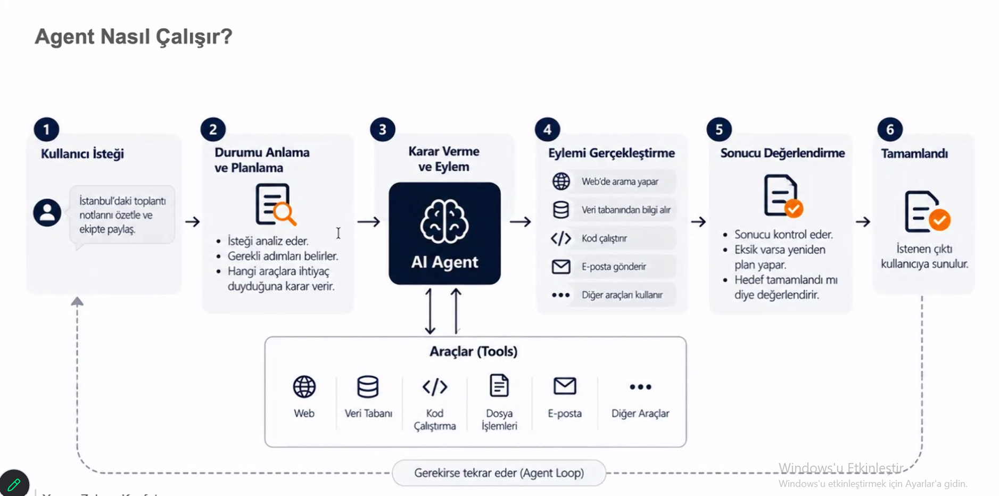
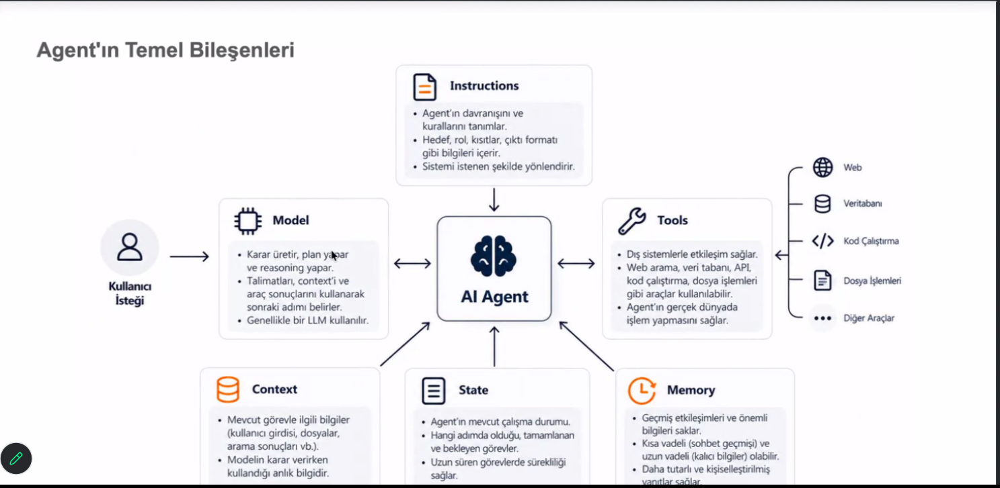
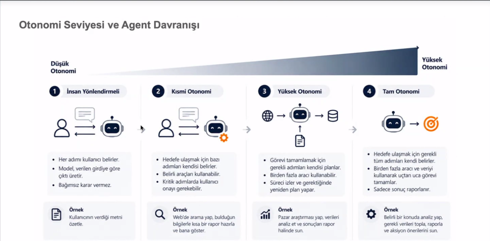

I. AI Agent, belirli bir hedef doğrultusunda karar verebilen, gerektiğinde tool(araç) kullanabilen ve sonucu üretmek için eylem gerçekleştirebilen yapay zaka sistemidir.

    

-- HuggingFace --> ana mantığı yazılım senden donanım benden mantıklı proje aslında. Bir nevi AI - githup diyebilriiz.

II. Agent Temel Bileşenleri.

    

    II.I) Agent Katmanları nelerdir ? 

        [ Dış Dünya / Girdi ]
               │
               ▼
        ┌─────────────────────────────────────────────────────────┐
        │ 1. Algılama ve Girdi Katmanı (Perception)               │
        └─────────────────────────────────────────────────────────┘
               │
               ▼
        ┌─────────────────────────────────────────────────────────┐
        │ 2. Güvenlik & Girdi Filtreleme (Guardrails / PII)      │
        └─────────────────────────────────────────────────────────┘
               │
               ▼
        ┌─────────────────────────┐     ┌─────────────────────────┐
        │ 3. Bilişsel Karar       │ ◄──►│ 4. Bellek & RAG         │
        │    (LLM / Agent Logic)  │     │    (Vector DB / State)  │
        └─────────────────────────┘     └─────────────────────────┘
               │ (Tool Call İsteği)
               ▼
        ┌─────────────────────────────────────────────────────────┐
        │ 5. Araç & Protokol Katmanı (MCP / APIs / Tools)         │
        └─────────────────────────────────────────────────────────┘
               │
               ▼
        ┌─────────────────────────────────────────────────────────┐
        │ 6. Harness & Yönetişim (Business Rules / Auth / HITL)   │
        └─────────────────────────────────────────────────────────┘
               │ (Onaylanan İşlem)
               ▼
        ┌─────────────────────────────────────────────────────────┐
        │ 7. Yürütme Katmanı (Sandbox / Core APIs / DB Operations)│
        └─────────────────────────────────────────────────────────┘
               │
               ▼
        ┌─────────────────────────────────────────────────────────┐
        │ 8. Gözlemlenebilirlik & Izleme (Tracing / Audit Logs)   │
        └─────────────────────────────────────────────────────────┘

    II.II) Idempotency muhabbeti nedir agentlarda ? 

        Tipik bir senaryo:

        Müşteri "Öde" butonuna basar ve kartından 100 TL çekilmesi için istek (POST) atılır.

        İstek bankanın acquiring (ödeme alım) sistemine ulaşır, karttan para çekilir ancak tam istemciye (client) yanıt dönerken ağ kopar       (timeout).

        Müşteri ekranın donduğunu zannedip "Öde" butonuna tekrar basar.

        Eğer sistem idempotent tasarlanmamışsa, müşteri istemeden iki kez 100 TL ödemiş olur.

        Agentlarda da aynı muhabbet, eğer riskli/hatalı bir durum varsa agent tekrar tekrar aynı işlemi yapmasın da varolanı göndersin gibi bir senaryo.

    II.III) Otonomi (Özerklik / Bağımsızlık), 
    
        Bir sistemin, organizmanın veya ajanın dışarıdan bir müdahaleye, doğrudan kontrol veya insan komutuna ihtiyaç duymadan kendi kararlarını alma, hedeflerini belirleme ve bu hedeflere ulaşmak için eylemlerini kendi iç dinamikleriyle yürütme yeteneğidir.

        Kelime kökeni olarak Yunanca autos (kendi) ve nomos (yasa/kural) sözcüklerinden gelir; yani "kendi kurallarını koyabilme ve kendi       kendini yönetebilme" gücüdür.

        Farklı Alanlarda Otonomi
        Otonomi kavramı kullanıldığı disipline göre farklı anlamlar taşır:

        1. Yapay Zeka ve Ajan Mimarisinde Otonomi
        Yazılım ve AI dünyasında otonomi, sistemin ne kadar "kendi başına" çalışabildiğini ifade eder:

        Tam Otonom Sistem (Fully Autonomous Agent): Bir hedef verdiğinizde ("Kod tabanındaki güvenlik açıklarını tara ve PR aç"), hangi         adımları atacağına, hangi araçları sırayla kullanacağına kendisi karar verir. Hata aldığında kendi kendini düzeltir ve insan        müdahalesi olmadan işi bitirir.

        Yarı Otonom / Denetimli (Semi-Autonomous / Human-in-the-Loop): Ajan analiz eder, planı çıkarır, adımları yürütür ancak kritik       eylem katmanında (örneğin veritabanına yazma veya canlıya alma) insandan veya bir kontrol katmanından (Harness) onay alır.

        Otomasyon ile Otonomi Arasındaki Fark:

        Otomasyon (Automation): Önceden tanımlanmış sabit bir kural dizisini (IF-THEN) kuralcı bir şekilde tekrarlar. Esneklik veya karar       verme mekanizması yoktur. (Örn: Bir cron job'ın her gece 00:00'da veritabanı yedeği alması).

        Otonomi (Autonomy): Değişen koşullara, bilinmeyen durumlara veya beklenmedik hatalara adapte olarak hedef doğrultusunda yeni        kararlar alabilir. (Örn: Yedekleme sırasında hata aldığında alternatif sunucuyu bulup, disk alanını temizleyip yedeği oraya almayı      başaran bir AI ajanı).

            Otonomi Seviyeleri (Örnek: AI & Otonom Sistemler)
            Sistemler genellikle sıfır otonomiden tam otonomiye doğru şu seviyelerle derecelendirilir:

            Seviye 0 (Hiç Otonom Değil): Tamamen manuel kontrol.

            Seviye 1 (Yardımcı): Sistem sadece öneri sunar (Kullanıcıya kod öneren auto-complete).

            Seviye 2 (Kısmi Otonomi): Belirli dar görevleri kendi yapar ama insan sürekli denetler.

            Seviye 3 (Koşullu Otonomi): Beklenen durumlarda kendi çalışır, belirsizlik anında insanı çağırır.

            Seviye 4 (Yüksek Otonomi): Belirli sınırlar içinde insan müdahalesi olmadan uçtan uca çalışır.

            Seviye 5 (Tam Otonomi): Her koşulda, hiçbir dış talimata veya insana ihtiyaç duymadan tüm süreci yönetir.

        
        

        