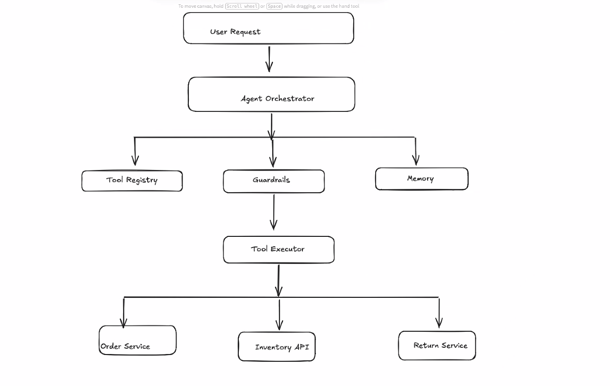

--> Ilk agent yaratımı ; 

    * Single Agent : Görev yönetiminin tek bir mekanizmadan geçtiği bir yapı.

        --> Tool Registry : Tool Seçimi
        --> Guardrails
            --> Tool Executer --> Sonrasında çıktılarımızı göreceğiz.

                * Örnğ; Order Service / Inventory API / Return Service

        --> Memory :
        
        