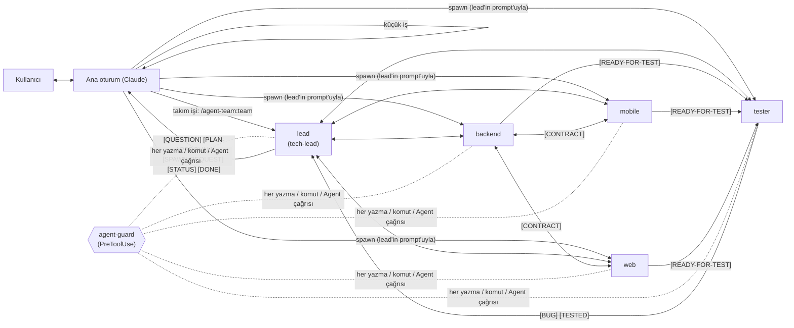

# agent-team

**agent-team**, Claude Code için generic, çok-agent'lı bir yazılım takımı framework'üdür. Bir tech-lead (mimar ve organizatör) ile backend, mobile, web ve tester rollerinden oluşan bir takımı; yetki guard'ını, kanıt kuralını, görev kapanış kapısını ve commit öncesi inceleme hattını **tek bir plugin** olarak herhangi bir projeye bağlamanızı sağlar.

Framework projeden bağımsızdır. Projeye ait bağlam, kurallar, hafıza ve yığın seçimi framework'te değil, ürün reposundaki `AdditionalAgentInformation/` klasöründe durur.

```
/plugin install agent-team --marketplace BunyaminAslan/Softtech-BootsCamp
```

Eski sürümlerde (Claude Code < 2.1.275) iki adımda:

```
/plugin marketplace add BunyaminAslan/Softtech-BootsCamp
/plugin install agent-team@agent-team-marketplace
```

Kurulum, proje bağlama ve hook/guard ayrıntıları: **[PLUGIN.md](PLUGIN.md)**.

---

## İçindekiler

1. [Nasıl çalışır](#1-nasıl-çalışır)
2. [Katmanlar: framework, profil, proje](#2-katmanlar-framework-profil-proje)
3. [Roller](#3-roller)
4. [Bir isteğin yaşam döngüsü](#4-bir-isteğin-yaşam-döngüsü)
5. [Kalite kapıları](#5-kalite-kapıları)
6. [Commit öncesi inceleme hattı](#6-commit-öncesi-inceleme-hattı)
7. [Repo yapısı](#7-repo-yapısı)
8. [Bilinen sınırlamalar ve doğrulama durumu](#8-bilinen-sınırlamalar-ve-doğrulama-durumu)
9. [Framework'ü geliştirmek](#9-frameworkü-geliştirmek)

---

## 1. Nasıl çalışır

Kullanıcı her zaman **ana oturumla** (Claude) konuşur; hiçbir agent varsayılan ana agent yapılmaz. Ana oturum işi kendisi yapar ya da takım gerektiren işleri **tech-lead**'e paslar. Takımı yalnızca ana oturum başlatır; bu, Claude Code'un "teammate'ler teammate başlatamaz" kısıtının sonucudur.



- **SessionStart hook'u** ana oturuma yönlendirme kurallarını ve proje katmanının durumunu enjekte eder (plugin'deki `CLAUDE.md` bağlama yüklenmediği için).
- **agent-guard**, plugin genelinde çalışan bir PreToolUse hook'udur. Çağıranın takım rolünü hook girdisindeki `agent_type` alanından belirler ve rolün yetkilerini, projenin `team.json` dosyasındaki alan sahipliğiyle birlikte uygular. Ana oturum ve takım dışı agent'lar kısıtlanmaz.

## 2. Katmanlar: framework, profil, proje

| Katman | Nerede | Ne içerir | Kim değiştirir |
|---|---|---|---|
| **Framework** | `plugin/` (kurulunca plugin önbelleği) | Rol tanımları (`agents/`), ortak kurallar (`TEAM_RULES.md`), guard ve hook'lar, ön kontrol ve kurulum betikleri, generic skill'ler, Playwright MCP | Framework sahibi |
| **Profil** | `plugin/profiles/<rol>/<ad>.md` veya `AdditionalAgentInformation/profiles/<ad>.md` | Bir yığının (ör. `backend/dotnet`, `mobile/flutter`, `web/nextjs`) kütüphaneleri, konvansiyonları, komutları, DoD ekleri, önerilen proje skill'leri | Framework sahibi / proje |
| **Proje** | Ürün reposunda `AdditionalAgentInformation/` | `project.md` (bağlam, dil, yığın, komutlar, ortam), `rules.md`, `team.json` (roller, profiller, yollar, korumalı yollar), `agents/<rol>/` (talimat, hafıza, worklog) | Kullanıcı; agent'lar yalnızca kendi hafıza/worklog'unu |
| **Proje uzantıları** | Ürün reposunda `.claude/skills/`, `.mcp.json`, `.claude/settings.json` | Projeye özel skill'ler, MCP sunucuları, izinler | Kullanıcı |

**Öncelik:** `TEAM_RULES.md` > agent dosyası > profil > `rules.md` / `instructions.md`. Alt katmanlar üst katmanları genişletir, gevşetemez.

Ajanlarda `tools:` allowlist'i yoktur (yalnızca `disallowedTools: Agent`). Bu sayede projenin `.mcp.json` dosyasındaki MCP araçları ve `.claude/skills/` altındaki skill'ler ajanlara ulaşır. Sınırlar guard tarafından zorlanır.

## 3. Roller

| Teammate | Agent tipi | Model | Sorumluluk |
|---|---|---|---|
| `lead` | `agent-team:tech-lead` | oturumla aynı | Netleştirme, mimari (ARCHITECTURE, ADR), atomik görevler, bağımlılık grafiği ve dalgalar, takip, kapsam matrisi, kapanış. **Kod yazmaz.** |
| `backend` | `agent-team:senior-backend-developer` | opus | API, domain, DB, migration, güvenlik; API sözleşmesinin sahibi |
| `mobile` | `agent-team:senior-mobile-developer` | opus | Mobil mimari, ekranlar, offline, güvenlik, performans, store hazırlığı |
| `web` | `agent-team:senior-web-developer` | opus | Web mimarisi, SEO, erişilebilirlik, Core Web Vitals, tasarım sistemi, animasyon |
| `tester` | `agent-team:senior-tester` | sonnet | Test stratejisi, E2E/API/yük/erişilebilirlik testleri, bug raporları, go/no-go. **Üretim koduna yazmaz.** |

Commit öncesi hattın ajanları: `agent-team:precommit-lead`, `agent-team:pre-commit-reviewer`, `agent-team:sprint-documenter` (Bölüm 6).

Kullanılmayan roller projede `team.json > roles.<rol>.enabled: false` ile kapatılır; lead kapalı rolleri başlatmaz.

**Özel roller:** `team.json > roles` ile framework kodunu değiştirmeden projeye rol eklenir (ör. DevOps, güvenlik incelemesi, teknik yazar). Rolün ajanı, yetki türü (`developer`, `reviewer`, `docs`, `allowlist`) ve yolları yapılandırmadan okunur; guard, ön kontrol, kanıt kaydı ve görev kapısı bu rolleri de kapsar. Ayrıntı: [PLUGIN.md > 5.1](PLUGIN.md).

## 4. Bir isteğin yaşam döngüsü

1. **Yönlendirme:** Ana oturum işi kendisi yapar ya da `agent-team:team` prosedürüyle `lead`'i başlatır (önce `team-preflight.js` ön kontrolü).
2. **Netleştirme:** lead en fazla 5 kritik soruyu `[QUESTION]` ile sorar; ana oturum soruları kullanıcıya aynen iletir.
3. **Mimari ve plan:** VISION, ARCHITECTURE, ADR'ler (UI varsa tasarım dili ADR'si, K4). Ana hedef → story → atomik görev zinciri, kapsam matrisi, Mermaid bağımlılık grafiği, paralel dalgalar (W1..Wn), kritik yol.
4. **Onay:** `[PLAN-APPROVAL]`; kullanıcı onaylamadan sprint başlamaz.
5. **Takım:** lead `[SPAWN-REQUEST]` gönderir; ana oturum üyeleri **lead'in prompt'uyla, değiştirmeden** başlatır. Yalnızca o dalgada işi olan roller açılır (maliyet ve limitler).
6. **Yürütme:** Üyeler görevleri ortak görev listesinden alır ve sözleşme üzerinden konuşur (`[CONTRACT]`, `[CONTRACT-REQUEST]`, `[READY-FOR-TEST]`, `[BUG]`, `[FIX]`). lead bağımlılıkları açar, takılanları çözer, `STATUS.md`'yi günceller ve dalga sonlarında **commit noktası** önerir.
7. **Kapanış:** Kapsam matrisi doğrulanır, tester go/no-go verir, lead `[DONE]` gönderir. Commit kullanıcınındır.

**Özerklik ve model:** `team.json > autonomy` lead'in ne zaman durup soracağını (`supervised`, `checkpoint`, `autonomous`), `models` teammate'lerin hangi modelle başlatılacağını belirler; sprint sonunda `scripts/usage-report.js` model ve rol bazında token kullanımını raporlar.

**Kesinti:** Limit dolar veya oturum kapanırsa `/agent-team:resume` plan dokümanlarından, görev listesinden, worklog'lardan, kanıt kaydından ve git durumundan bir devam özeti çıkarır; lead devam modunda yalnızca yarım kalan işin sahiplerini yeniden başlattırır (PLUGIN.md > 7.6).

## 5. Kalite kapıları

| Kapı | Ne yapar | Nerede |
|---|---|---|
| **agent-guard** | Rol bazlı yazma/komut yetkileri: başka rolün klasörüne yazma, sözleşmeye backend dışında yazma, korumalı yollar (`.claude/`, `.githooks/`, `.github/`, `.mcp.json`, `.env`, anahtarlar, `AdditionalAgentInformation/` kullanıcı dosyaları), git geçmişini değiştiren komutlar, deploy/publish, sistem kurulumu, `sudo`, indir-çalıştır, alt agent başlatma. Bash ile yazma girişimlerini de (`>`, `tee`, `sed -i`, `cp`, `mv`, PowerShell cmdlet'leri) ayrıştırır. **Fail-closed:** node yoksa, `team.json` bozuksa veya çağıranın türü belirlenemiyorsa agent çağrısı engellenir. | `plugin/hooks/agent-guard.js`, `guard.sh` |
| **K1 kanıt kuralı** | "Bitti/geçti" diyen her mesaj ve görev kapanışı komut + dizin + gerçek sonuç + `Kanıt: L-…` kimliği içerir. Takım rollerinin her komutu hook tarafından proje dışındaki hash zincirli bir kanıt kaydına yazılır; TaskCompleted hook'u atfedilen kimliği kayıttan doğrular (rol, agent, exit 0, tazelik, tekrar kullanım). Varsayılan `warn` modunda kanıtsız kapanış engellenmez ama ajana, lead'e ve kullanıcıya ciddi uyarı gider ve `STATUS.md`'de `⚠️ Kanıtsız` görünür; `enforce`/`strict` modunda engellenir. | `TEAM_RULES.md`, `plugin/hooks/ledger-record.js`, `plugin/hooks/task-completed.js`, `plugin/scripts/ledger.js` |
| **Sandbox (ikinci katman)** | macOS, Linux ve WSL2'de `setup-project`, Claude Code sandbox'ını projenin `.claude/settings.json` dosyasına birleştirerek açar: Bash komutları proje dışına yazamaz, ağ erişimi profillerin ve `team.json`'un izin verdiği alan adlarıyla sınırlanır. Guard'ın çözemediği değişkenli yazmaları kapatır ve kanıt kaydını işletim sistemi düzeyinde korur. Ön kontrol bağımlılıkları (`bwrap`, `socat`) ve eksik alan adlarını denetler. | `plugin/hooks/lib/sandbox.js`, `plugin/scripts/setup-project.js`, profillerin "Ağ izinleri" bölümü |
| **Tasarım kapısı (K8)** | `UI: evet` işaretli görev; her varyantın (mobil/masaüstü × açık/koyu) ekran görüntüsü, tasarım ADR'sine göre puanlı inceleme (`impeccable critique`) ve `Tasarım:` satırıyla kapanır. Hook dosyayı, puan eşiğini ve görüntüleri denetler; `warn` modunda `⚠️ Tasarım`, `enforce` modunda engel. | `TEAM_RULES.md` K8, `plugin/hooks/lib/design.js`, `templates/project/Docs/Design/reviews/_TEMPLATE.md` |
| **Ön kontrol** | Takım başlamadan: ajan tanımları, node, proje katmanı ve `team.json`, profiller, gerçek hook girdisiyle guard denemeleri, agent teams ayarı, pre-commit bağlantısı. | `plugin/scripts/team-preflight.js` |
| **Pre-commit hattı** | Commit öncesi kod incelemesi (SOLID, testler, güvenlik), eksik testlerin yazılıp çalıştırılması ve sprint dokümanı. | Bölüm 6 |
| **Bildirimler** | lead `[QUESTION]`, `[PLAN-APPROVAL]`, `[BLOCKED]` veya `[DONE]` gönderip beklemeye geçince sohbet mesajı ve masaüstü bildirimi (`CLAUDE_TEAM_NOTIFY=0` ile kapatılır). | `plugin/hooks/subagent-stop.js` |

Ortak kurallar (`TEAM_RULES.md`):
- **K1:** kanıt kuralı
- **K2:** sunucu ve watch komutları ön planda çalıştırılmaz
- **K3:** animasyon kalitesi
- **K4:** tasarım ADR'si
- **K5:** bitti kriterlerinde bitmeyen komut olmaz
- **K6:** şablonların ürettiği dosyalar raporlanır
- **K7:** sözleşme sürüm bildirimi

## 6. Commit öncesi inceleme hattı

`/agent-team:setup-project --githooks` ürün reposuna `.githooks/pre-commit` ve `.githooks/review-cache.js` kurar ve `core.hooksPath` değerini ayarlar. Her `git commit`'te:

1. **Önbellek kontrolü:** Staged diff hunk bazında son incelemeyle karşılaştırılır. Diff değişmediyse agent çalışmaz ve önceki karar kullanılır. Bir kısmı değiştiyse yalnızca değişen hunk'lar incelenir.
2. `claude -p --agent agent-team:precommit-lead` (HOOK MODU) sırayla `agent-team:pre-commit-reviewer` ve `agent-team:sprint-documenter`'ı çağırır.
3. **Reviewer:** SOLID ve tasarım, eksik unit testleri yazıp çalıştırma, güvenlik (OWASP), agent hafızasında sır veya kişisel veri kontrolü.
4. **Documenter:** `Docs/Sprint_<commit-no>.md` (özet, değişen dosyalar, Mermaid diyagramları, test sonuçları, bulgular).
5. **Karar:** Build hatası, başarısız test, Kritik/Yüksek bulgu veya Orta+ güvenlik bulgusu varsa commit **engellenir** (`LEAD_VERDICT: FAIL`). Geçerse sprint dokümanı commit'e eklenir.

Notlar:
- Acil durumda `git commit --no-verify` ile atlanabilir.
- Tam yeniden inceleme için `PRECOMMIT_FORCE=1 git commit ...`; önbelleği sıfırlamak için `node .githooks/review-cache.js reset`.
- Reviewer'ın yazdığı testler commit'e otomatik eklenmez; incelenip `git add` yapılır.
- Log: `.git/precommit-lead/last-run.log`. Bir commit birkaç dakika sürebilir.
- Etkileşimli kullanım: `claude --agent agent-team:precommit-lead` ile reviewer ve documenter teammate olarak çalışır.

## 7. Repo yapısı

```
.
├── .claude-plugin/marketplace.json     # marketplace kataloğu (kaynak: ./plugin)
├── plugin/                              # ← kurulan plugin (yalnızca bu klasör kopyalanır)
│   ├── .claude-plugin/plugin.json      # ad, sürüm
│   ├── agents/                          # tech-lead, senior-*, precommit-lead, pre-commit-reviewer, sprint-documenter
│   ├── hooks/                           # hooks.json, agent-guard.js, guard.sh, session-start, subagent-start,
│   │   └── lib/                         #   ledger-record, task-completed, subagent-stop; lib: team-config (rol/team.json), ledger (kanıt kaydı), sandbox
│   ├── scripts/                         # team-preflight.js, setup-project.js, onboard-scan.js, resume-status.js, ledger.js
│   ├── skills/                          # team, setup-project, onboard, resume + incelenmiş generic skill'ler (README.md)
│   ├── profiles/                        # yığın profilleri: backend/{dotnet,node,python}, mobile/{flutter,react-native-expo,native}, web/{nextjs,aspnet-mvc}
│   ├── templates/                       # proje katmanı, Docs/Project & ADR şablonları, githooks
│   ├── TEAM_RULES.md                    # ortak takım kuralları (K1–K8, proje katmanı, iletişim)
│   └── .mcp.json                        # Playwright MCP (sürüm sabit)
├── tests/hooks/                         # hook/betik birim testleri (L0; dağıtılmaz, CI ve pre-commit çalıştırır)
├── .githooks/pre-commit                 # bu reponun kendi kontrolü: testler + plugin validate
├── .github/workflows/agent-team.yml     # CI
├── CLAUDE.md                            # bu repoda framework geliştirirken Claude'a talimatlar
├── PLUGIN.md                            # bir projeye bağlama rehberi
├── CHANGELOG.md
└── README.md
```

## 8. Bilinen sınırlamalar ve doğrulama durumu

| Konu | Durum |
|---|---|
| Plugin yükleme, SessionStart bağlamı, ajanların `agent-team:` adlarıyla görünmesi | ✅ Canlı doğrulandı (`claude --plugin-dir`, WSL) |
| Guard'ın plugin **subagent**'ında çalışması (`agent_type` hook girdisinde) | ✅ Canlı doğrulandı ve her sürümde `evals/smoke` ile ölçülüyor: backend `mobile/` klasörüne yazamıyor, `backend/` klasörüne yazabiliyor; lead kaynak koda yazamıyor |
| Kanıt kaydı, sandbox | ✅ Canlı doğrulandı (WSL2): komut kaydı ve `Kanıt: L-…` kimliği; sandbox'ta proje dışına yazma engeli, yerel ayarla kişisel kapatma |
| Guard'ın agent team **teammate**'lerinde çalışması | ⏳ Etkileşimli oturum gerektirir (`-p` modunda teammate açılmaz). Teammate'te `agent_type` gelmezse SubagentStart kaydı, o da yoksa fail-closed engelleme devreye girer, yani sessiz bir açık oluşmaz. İlk gerçek takım koşusunda doğrulanmalı (PLUGIN.md > Doğrulama). |
| `teammateMode: "tmux"` (split-pane) teammate'lerinde `disallowedTools` | Claude Code dokümanına göre yalnızca in-process modda kesin; guard her iki modda da `Agent` aracını engeller |
| Agent teams | Deneysel bir Claude Code özelliği (`CLAUDE_CODE_EXPERIMENTAL_AGENT_TEAMS=1`); oturum devamında in-process teammate'ler geri gelmez |
| Görev araçları | Güncel modellerde (Claude 5 ailesi) opt-in: `CLAUDE_CODE_ENABLE_TODO_TOOLS=1` olmadan görev listesi ve kanıt kapısı çalışmaz (PLUGIN.md §2) |
| Windows | Hook'lar Git Bash (`sh`) ile çalışır; Git Bash yoksa guard çalışamaz ve PreToolUse çağrıları engellenebilir. Önerilen ortam WSL veya macOS/Linux |
| Lisans | Framework için henüz lisans seçilmedi (plugin dizini kataloğu LICENSE ister; kendi marketplace'iniz için zorunlu değil) |

## 9. Framework'ü geliştirmek

```sh
node --test tests/hooks/*.test.js   # guard, kanıt kaydı, sandbox, görev kapısı, kurulum, ön kontrol, plugin bütünlüğü
claude plugin validate ./plugin     # plugin
claude plugin validate .            # marketplace
claude --plugin-dir ./plugin        # kurmadan bir ürün reposunda deneme (o reponun kökünde)
evals/run.sh smoke                  # ajan davranış testleri (L1; gerçek model çağrısı, ≈ $1.5)
evals/run.sh full                   # sürüm öncesi (L2)
```

Davranış testlerinin katmanları, vakaları ve yazma kuralları: [evals/README.md](evals/README.md).

Bu reponun `.githooks/pre-commit` hook'u testleri ve doğrulamayı her commit'te çalıştırır (`git config core.hooksPath .githooks`). Kurallar: [CLAUDE.md](CLAUDE.md). Sürüm değişiklikleri: [CHANGELOG.md](CHANGELOG.md).
