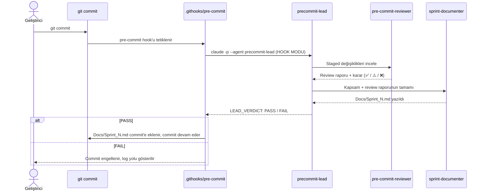
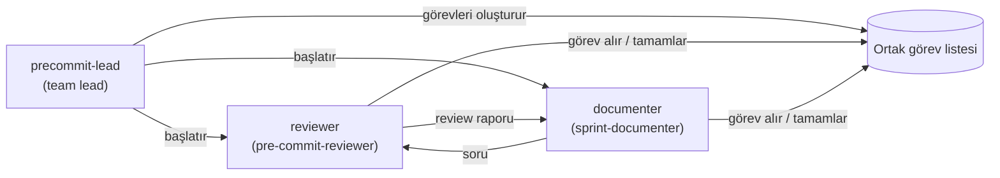

# Softtech BootsCamp

Bu projede her commit öncesinde Claude Code agent'ları değişiklikleri otomatik olarak inceler, test eder ve dokümante eder. Kontrolden geçmeyen değişiklikler commit edilemez.

Bu doküman sistemin nasıl çalıştığını, nasıl kurulacağını ve günlük kullanımda bilinmesi gerekenleri anlatır.

---

## İçindekiler

1. [Genel Bakış](#1-genel-bakış)
2. [Kurulum](#2-kurulum)
3. [Günlük Kullanım](#3-günlük-kullanım)
4. [Commit Ne Zaman Engellenir?](#4-commit-ne-zaman-engellenir)
5. [Sprint Dokümanları](#5-sprint-dokümanları)
6. [Bilinmesi Gerekenler](#6-bilinmesi-gerekenler)
7. [Sorun Giderme](#7-sorun-giderme)
8. [Dosya Yapısı](#8-dosya-yapısı)
9. [Agent Team Modu](#9-agent-team-modu)

---

## 1. Genel Bakış

Sistem üç agent ve bir git hook'undan oluşur:

| Bileşen | Görevi |
|---|---|
| `precommit-lead` | Pre-commit takımının lideri. Etkileşimli oturumda takımı kurar ve koordine eder; commit sırasında alt agent'ları sırayla çağırır. Kendisi kod incelemez, dosya yazmaz. |
| `pre-commit-reviewer` | Değişiklikleri SOLID ve yazılım tasarımı açısından inceler, eksik unit testleri yazıp çalıştırır, güvenlik taraması yapar ve bir karar verir (✅ / ⚠️ / ❌). |
| `sprint-documenter` | Değişiklikleri, akış diyagramlarını ve reviewer'ın raporunu `Docs/Sprint_{N}.md` dosyasına yazar. |
| `.githooks/pre-commit` | Her `git commit`'te `precommit-lead`'ı çalıştırır, sonuca göre commit'i durdurur ya da devam ettirir. |

### Akış



Bir subagent başka bir subagent'ı çağıramadığı için `precommit-lead` subagent olarak değil, ana oturum agent'ı olarak çalışır. Reviewer'ın raporu sprint-documenter'a dosya üzerinden değil, doğrudan precommit-lead aracılığıyla aktarılır.

---

## 2. Kurulum

Repoyu klonlayan herkesin aşağıdaki adımları **bir kez** yapması gerekir.

### 2.1. Claude Code

Hook, Claude Code CLI'ını kullanır. Önce PATH'teki `claude` komutunu arar, bulamazsa VS Code eklentisinin içindeki `claude.exe`'yi kullanır.

- VS Code'da **Claude Code** eklentisi kuruluysa ek bir şey gerekmez.
- Eklenti yoksa ya da terminalden de kullanmak istiyorsanız CLI'ı kurun:

  ```bash
  npm install -g @anthropic-ai/claude-code
  ```

- Claude Code'a en az bir kez giriş yapmış olmanız gerekir (`claude` komutunu çalıştırıp oturum açın).

### 2.2. Git hook'unu etkinleştirme

Git, hook klasörünü repo ile birlikte taşımaz. Klonladıktan sonra proje kök dizininde şunu çalıştırın:

```bash
git config core.hooksPath .githooks
```

Kontrol etmek için:

```bash
git config core.hooksPath
# Çıktı: .githooks
```

> ⚠️ Bu adım atlanırsa commit'ler **hiçbir kontrol yapılmadan** atılır.

### 2.3. Agent izinleri

Hook, agent'ları soru sorulamayan bir modda çalıştırır. Bu modda izin verilmemiş komutlar sessizce reddedilir. İzinler eksikse agent'lar değişiklikleri okuyamaz ya da testleri çalıştıramaz ve her commit engellenir.

[.claude/settings.json](.claude/settings.json) dosyasında şu izinlerin bulunduğundan emin olun:

```json
{
  "agent": "precommit-lead",
  "permissions": {
    "allow": [
      "Bash(git status *)", "Bash(git diff *)", "Bash(git log *)",
      "Bash(git rev-list *)", "Bash(git rev-parse *)", "Bash(git branch *)",
      "Bash(git config user.name)", "Bash(date *)", "Bash(mkdir *)",
      "Bash(dotnet build *)", "Bash(dotnet test *)", "Bash(dotnet list package *)",
      "Bash(npm test *)", "Bash(npm run test *)", "Bash(npm run build *)", "Bash(npm audit *)",
      "Bash(npx jest *)", "Bash(npx vitest *)", "Bash(mvn test *)", "Bash(gradle test *)",
      "Bash(pytest *)", "Bash(python -m pytest *)"
    ]
  }
}
```

Bu listede yalnızca okuma, build ve test komutları vardır. `git add`, `git commit`, `git push` ve dosya silme gibi komutlar bilerek dışarıda bırakılmıştır. Projeye yeni bir build veya test aracı eklenirse ilgili komutu da bu listeye ekleyin.

Dosya düzenleme izinleri hook tarafından `--permission-mode acceptEdits` ile verilir. Agent'ların kendi kuralları gereği reviewer yalnızca test dosyalarına, sprint-documenter yalnızca `Docs/` klasörüne yazar.

---

## 3. Günlük Kullanım

### Otomatik (commit sırasında)

Normal şekilde commit atın; kontrol kendiliğinden çalışır:

```bash
git add .
git commit -m "Sipariş servisine iptal özelliği eklendi"
```

Terminalden, VS Code'un Source Control panelinden ya da Claude'dan atılan bütün commit'ler bu kontrolden geçer.

Commit sırasında şuna benzer bir çıktı görürsünüz:

```
🔍 precommit-lead commit öncesi kontrolü çalıştırıyor (birkaç dakika sürebilir)...
... (review ve dokümantasyon özeti) ...
LEAD_VERDICT: PASS
✅ precommit-lead kontrolü geçti, commit devam ediyor.
```

### Manuel (commit atmadan önce)

Commit'i beklemeden değişikliklerinizi kontrol ettirmek isterseniz, bu projede Claude Code oturumu açın. `.claude/settings.json` içindeki `"agent": "precommit-lead"` ayarı sayesinde oturum doğrudan precommit-lead ile başlar:

```
değişikliklerimi commit öncesi kontrol et
```

Manuel modda agent'lar gerektiğinde size soru sorabilir. Commit atmazlar; commit kararı her zaman sizdedir.

---

## 4. Commit Ne Zaman Engellenir?

Reviewer kararını aşağıdaki kurallara göre verir:

| Karar | Koşul | Commit |
|---|---|---|
| ❌ COMMIT EDİLMEMELİ | Build hatası, **veya** başarısız test, **veya** herhangi bir kategoride Kritik/Yüksek bulgu, **veya** Orta ve üzeri herhangi bir güvenlik bulgusu (koda gömülü parola, API key, connection string dahil) | **Engellenir** |
| ⚠️ DÜZELTMELERLE COMMIT EDİLEBİLİR | Yukarıdakiler yok, ama Orta seviyeli tasarım/SOLID bulgusu veya Düşük/Bilgi seviyeli güvenlik bulgusu var | Devam eder |
| ✅ COMMIT EDİLEBİLİR | Diğer tüm durumlar | Devam eder |

Bunlara ek olarak commit şu durumlarda da engellenir:

- Claude CLI bulunamazsa
- Bir alt agent hata verirse ya da sprint dokümanı yazılamazsa
- Reviewer'ın kararı okunamazsa
- Çıktıda `LEAD_VERDICT: PASS` satırı yoksa (ör. oturum açılmamış, ağ hatası)

Sistem **güvenli tarafta kalacak** şekilde tasarlanmıştır: emin olamadığı her durumda commit'i engeller.

⚠️ kararı commit'i engellemez, ama bulgular sprint dokümanının "Açık Konular ve Teknik Borç" bölümüne yazılır. Bunları sonraki sprint'lerde ele almanız beklenir.

---

## 5. Sprint Dokümanları

Her commit için `Docs/Sprint_{N}.md` dosyası oluşturulur.

- **N**, atılacak commit'in sıra numarasıdır: `git rev-list --count HEAD + 1`. İlk commit `Sprint_1.md` olur.
- Kontrol geçerse doküman **aynı commit'e otomatik eklenir**.
- Kontrol başarısız olursa doküman yine yazılır ama commit'e eklenmez. Sorunları düzeltip tekrar commit attığınızda aynı dosya güncellenir ve "Revizyon Geçmişi" bölümüne yeni bir satır eklenir.

Doküman şu bölümlerden oluşur:

1. Özet
2. Değişen Dosyalar
3. Detaylı Değişiklik Açıklamaları
4. Akış Diyagramları (Mermaid: flowchart, sequence, class, state, ER, yalnızca gerektiğinde)
5. Test Sonuçları
6. Tasarım ve SOLID Değerlendirmesi
7. Güvenlik Değerlendirmesi
8. Açık Konular ve Teknik Borç
9. Revizyon Geçmişi

Diff'te görülen gizli bilgiler (parola, token vb.) dokümana `***` ile maskelenerek yazılır.

---

## 6. Bilinmesi Gerekenler

### ⏱️ Commit süresi

Her commit, agent'lar değişiklikleri inceleyip testleri çalıştırdığı için **birkaç dakika sürebilir**. Süre değişikliğin büyüklüğüne ve test paketine bağlıdır. Küçük ve odaklı commit'ler hem daha hızlı kontrol edilir hem de daha anlamlı dokümanlar üretir.

Staged değişiklik yoksa hook hiçbir şey yapmadan çıkar.

### 🚨 Kontrolü atlamak (acil durum)

Acil bir durumda (ör. canlı ortam hotfix'i, Claude servisine erişilemiyor) kontrolü atlayabilirsiniz:

```bash
git commit --no-verify -m "hotfix: ..."
```

> ⚠️ `--no-verify` ile atılan commit'ler için ne review yapılır ne de sprint dokümanı oluşturulur. Yalnızca gerçekten acil durumlarda kullanın ve sonrasında değişikliği manuel olarak kontrol ettirin (bkz. [Manuel kullanım](#manuel-commit-atmadan-önce)).

### 🧪 Reviewer'ın yazdığı testler commit'e otomatik eklenmez

`pre-commit-reviewer`, değişiklikleriniz için eksik unit testleri yazar ve çalıştırır. Bu test dosyaları **commit'e otomatik olarak eklenmez**. Commit'e dahil edilip edilmeyeceği sizin kararınızdır.

Commit sonrasında yazılan test dosyaları çalışma dizininizde staged olmayan dosyalar olarak kalır:

```bash
git status
```

Testleri inceleyin. Uygun bulduklarınızı ayrı bir commit ile ekleyin:

```bash
git add tests/...
git commit -m "Sipariş iptali için unit testler eklendi"
```

Bu commit de aynı kontrolden geçer. Yazılan testlerin listesi ayrıca sprint dokümanının "Test Sonuçları" bölümünde yer alır.

Projede henüz test projesi yoksa reviewer kendiliğinden test projesi oluşturmaz. Commit sırasında yalnızca test senaryolarını listeler; manuel modda ise hangi test framework'ünün kullanılacağını sorar.

### 👥 Ekip arkadaşları için hook ayarı

`core.hooksPath` ayarı her geliştiricinin kendi makinesindeki git yapılandırmasında tutulur ve **repo ile birlikte taşınmaz**. Repoyu klonlayan herkes bir kez şunu çalıştırmalıdır:

```bash
git config core.hooksPath .githooks
```

Bu ayarı yapmayan geliştiricilerin commit'leri hiçbir kontrolden geçmez. Yeni katılan ekip üyelerine bu adımı mutlaka hatırlatın.

### 🔒 Agent'ların yapamadıkları

Agent'lar kural gereği şunları **asla** yapmaz:

- `git add`, `git commit`, `git push`, `git reset`, `git checkout --` çalıştırmak. Commit kararı ve işlemi geliştiriciye aittir. (Tek istisna: kontrol geçtiğinde sprint dokümanını commit'e ekleyen `git add`, agent tarafından değil hook script'i tarafından yapılır.)
- Üretim kodunu değiştirmek. Reviewer bulduğu sorunlar için düzeltme önerir ama kodu siz düzeltirsiniz.

---

## 7. Sorun Giderme

### Commit neden engellendi?

Son çalışmanın tam çıktısı burada tutulur:

```
.git/precommit-lead/last-run.log
```

Bu dosya `.git` klasörünün içinde olduğu için commit'e girmez. Engellenme nedeni log'un sonundaki özette ve reviewer raporunun "Kritik / Yüksek Bulgular" bölümünde yazar.

### Sık karşılaşılan durumlar

| Belirti | Olası neden | Çözüm |
|---|---|---|
| `❌ Claude CLI bulunamadı` | CLI kurulu değil, VS Code eklentisi de yok | `npm install -g @anthropic-ai/claude-code` |
| Her commit engelleniyor, log'da izin reddi var | `.claude/settings.json` içinde izinler eksik | [2.3. Agent izinleri](#23-agent-izinleri) bölümündeki listeyi ekleyin |
| Log'da `LEAD_VERDICT` satırı yok | Claude'a giriş yapılmamış, ağ hatası veya kullanım limiti | `claude` komutunu çalıştırıp oturumun açık olduğunu kontrol edin |
| Commit kontrolsüz geçiyor | `core.hooksPath` ayarlanmamış | `git config core.hooksPath .githooks` |
| Hook çalışmıyor, `bad interpreter` hatası | Hook dosyası Windows satır sonlarıyla (CRLF) kaydedilmiş | `.gitattributes` dosyası bunu önler; dosyayı LF olarak kaydedin |
| Yeni eklenen test aracı çalışmıyor | Komut izin listesinde yok | İlgili komutu `.claude/settings.json` içindeki `allow` listesine ekleyin |

---

## 8. Dosya Yapısı

```
Softtech BootsCamp/
├── .claude/
│   ├── agents/
│   │   ├── precommit-lead.md         # Pre-commit takımının lideri
│   │   ├── pre-commit-reviewer.md    # SOLID, test ve güvenlik incelemesi
│   │   └── sprint-documenter.md      # Docs/Sprint_N.md dokümanını yazar
│   ├── hooks/
│   │   ├── subagent-stop.js          # Reviewer bitince chat'e "Aga ..." mesajı yazar
│   │   └── task-completed.js         # Sprint dokümanı eksikse görevin kapanmasını engeller
│   └── settings.json                 # Varsayılan agent, izinler, agent team ayarı ve hook'lar
├── .githooks/
│   └── pre-commit                    # Her commit'te precommit-lead'i çalıştırır
├── .gitattributes                    # Hook dosyalarının LF satır sonuyla kalmasını sağlar
├── Docs/
│   └── Sprint_N.md                   # Her commit için oluşturulan sprint dokümanları
└── README.md
```

### Sisteme yeni bir agent eklemek

1. `.claude/agents/` altına yeni agent dosyasını oluşturun.
2. [precommit-lead.md](.claude/agents/precommit-lead.md) içinde:
   - `tools:` satırındaki `Agent(...)` listesine yeni agent'ın adını ekleyin.
   - "Alt agent'lar" tablosuna ve "Akış" bölümüne yeni adımı ekleyin.
3. Agent yeni komutlar çalıştıracaksa bunları `.claude/settings.json` izin listesine ekleyin.

---

## 9. Agent Team Modu

Sistem iki farklı çoklu agent modeliyle çalışır. Hangisinin kullanılacağı, oturumun nasıl başlatıldığına bağlıdır.

| | Subagent modeli | Agent team modeli |
|---|---|---|
| **Ne zaman?** | Commit sırasında (`git commit` → hook → `claude -p`) | Claude oturumunda elle çalıştırıldığında |
| **İletişim** | precommit-lead reviewer'ın raporunu alır, documenter'a kendisi iletir | reviewer raporu **doğrudan** documenter'a gönderir; documenter reviewer'a soru sorabilir |
| **Çalışma sırası** | Sıralı: önce review, sonra doküman | Paralel: reviewer incelerken documenter değişiklikleri analiz eder |
| **Koordinasyon** | precommit-lead her şeyi yönetir | Ortak görev listesi + teammate'ler arası mesajlaşma |
| **Maliyet** | Daha düşük | Daha yüksek (her teammate ayrı bir Claude oturumu) |

Commit sırasında neden takım kullanılmıyor? Claude Code, etkileşimsiz (`-p`) modda teammate başlatmaz. Bu modda isim verilen agent'lar sıradan subagent olarak çalışır. Bu yüzden commit kontrolü her zaman subagent modeliyle yapılır.

### Takımın yapısı



### Görev listesi

| Görev | Sahibi | Bağımlılık |
|---|---|---|
| `[REVIEW] Kod incelemesi` | reviewer | — |
| `[DOC] Değişiklik analizi` | documenter | — |
| `[DOC] Sprint dokümanını tamamla` | documenter | `[REVIEW] Kod incelemesi` bitince açılır |

İlk iki görev paralel yürür. Üçüncü görev, review bitene kadar kilitli kalır.

### Takım hook'ları

| Olay | Script | Ne yapar? |
|---|---|---|
| `TaskCompleted` | [task-completed.js](.claude/hooks/task-completed.js) | `[DOC] Sprint dokümanını tamamla` görevi kapanmadan önce `Docs/Sprint_N.md` dosyasını kontrol eder. Dosya yoksa, zorunlu bölümler (Özet, Test Sonuçları, SOLID, Güvenlik) eksikse ya da review raporu işlenmemişse **exit 2** ile görevin kapanmasını engeller. Neden engellendiği documenter'a iletilir, o da eksiği tamamlar. |
| `TeammateIdle` | [subagent-stop.js](.claude/hooks/subagent-stop.js) | reviewer işini bitirdiğinde chat'e "Aga ..." mesajını yazar. |
| `SubagentStop` | [subagent-stop.js](.claude/hooks/subagent-stop.js) | Aynı mesajı commit sırasındaki subagent akışı için yazar. |

### Kullanım

1. Proje klasöründe terminal açın ve `claude` yazın. Oturum precommit-lead ile başlar.
2. `değişikliklerimi commit öncesi kontrol et` yazın.
3. precommit-lead görev listesini oluşturur ve iki teammate başlatır. Teammate'ler prompt kutusunun altındaki agent panelinde görünür:
   - **↑ / ↓**: teammate seç
   - **Enter**: teammate'in konuşmasını aç ve ona doğrudan mesaj yaz
   - **Ctrl+T**: görev listesini aç/kapat
   - **Esc**: seçimi kaldır
4. Tüm görevler tamamlanınca precommit-lead özeti sunar ve teammate'leri kapatır.

### Bilinmesi gerekenler

- **Deneysel özellik:** Agent team'ler Claude Code'da deneyseldir ve `.claude/settings.json` içindeki `CLAUDE_CODE_EXPERIMENTAL_AGENT_TEAMS=1` ayarıyla açılır. Kapatmak için değeri `0` yapın; sistem subagent modeliyle çalışmaya devam eder.
- **Terminal önerisi:** Takım modunu Claude Code CLI ile terminalde kullanın. Varsayılan "in-process" görünüm her terminalde çalışır. Her teammate'i ayrı panelde gösteren "split pane" görünümü VS Code'un terminalinde ve Windows Terminal'de desteklenmez.
- **Maliyet:** Her teammate ayrı bir Claude oturumudur, token kullanımı tek oturuma göre belirgin şekilde artar.
- **Oturuma devam etme:** `/resume` ve `/rewind` teammate'leri geri getirmez. Bir oturuma devam ettiyseniz precommit-lead'ten teammate'leri yeniden başlatmasını isteyin.
- **Takılan görevler:** Teammate'ler bazen görevi "tamamlandı" olarak işaretlemeyi unutur ve bağımlı görev kilitli kalır. Bu durumda precommit-lead'e ilgili teammate'i dürtmesini söyleyin.
