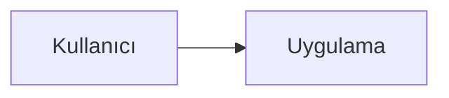

# {{PROJECT}}: Mimari

> Bu dosyanın sahibi `lead`'dir (tech-lead). Oluşturulma: {{DATE}}. Yapı: `tech-lead.md` Bölüm 4.3.

## 1. Bağlam

## 2. Bileşenler ve sorumluluk sınırları
| Bileşen | Sahip | Sorumluluk |
|---|---|---|

## 3. Teknoloji yığını

## 4. Veri modeli taslağı

## 5. Entegrasyon noktaları

## 6. Kesişen konular (hata yönetimi, loglama, güvenlik, offline, sürümleme, test stratejisi)

## 7. Riskler ve açık sorular
